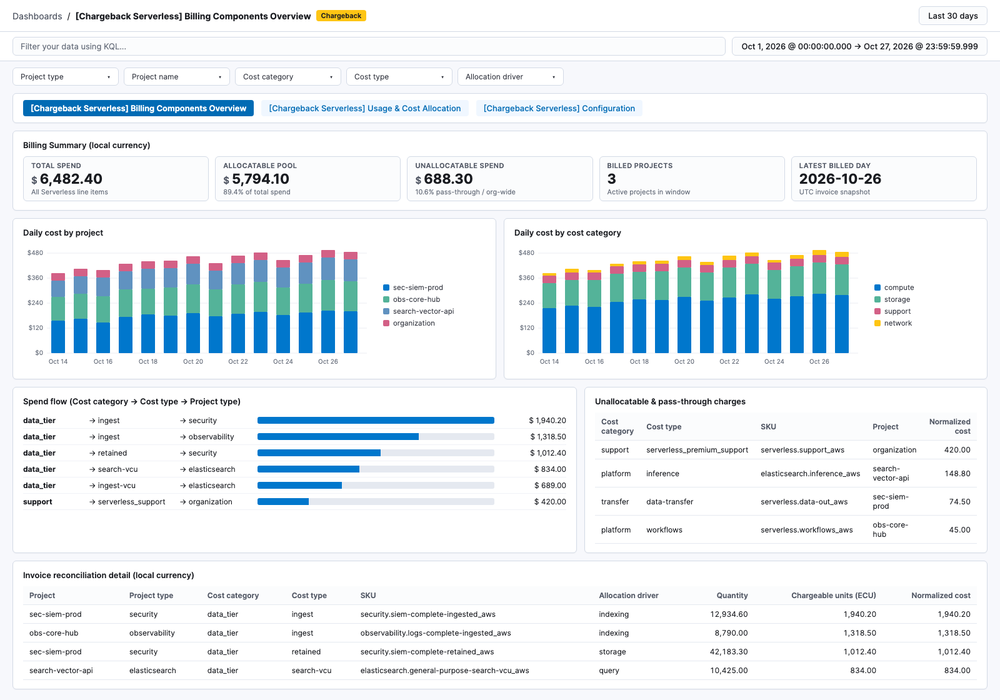
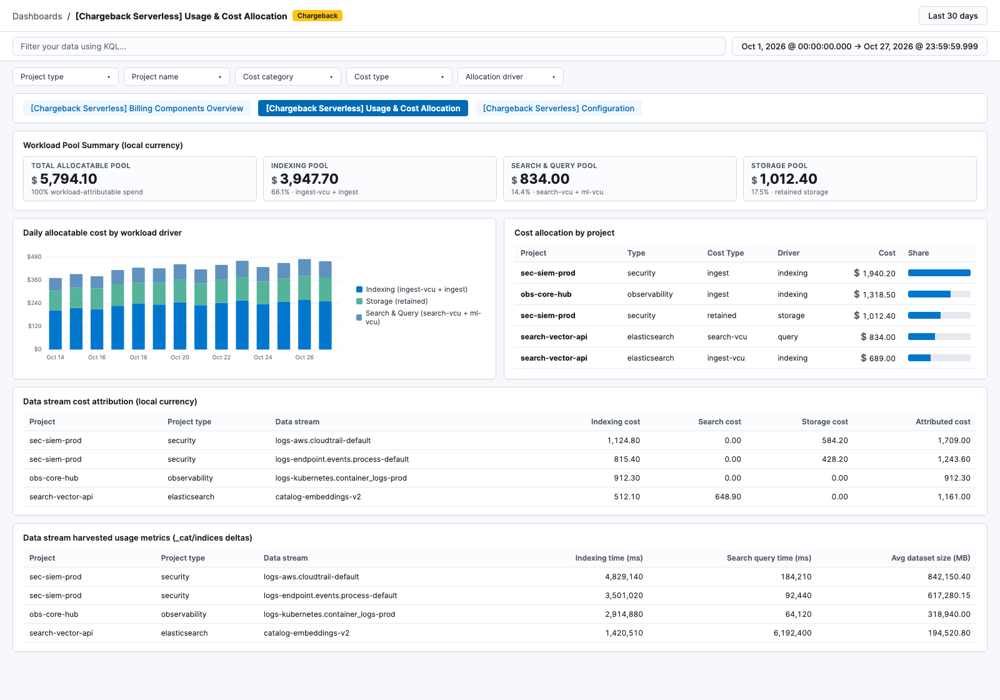
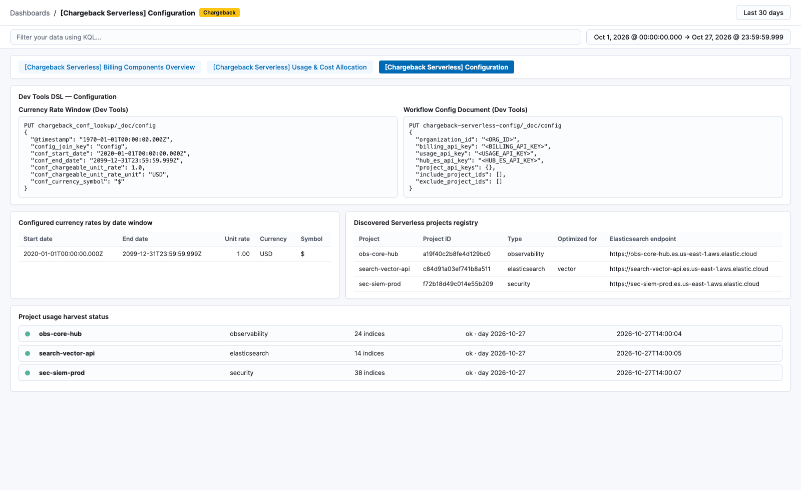

# Chargeback Serverless

Allocate Elastic Cloud Serverless billing to **projects** and **data streams** on a Serverless hub project.

This package is designed for **Serverless-only** organizations. For Hosted monitoring clusters (or combined Hosted and Serverless environments), use the `chargeback` integration with ESS Billing.

## Overview

- **Billing classification pipeline** (`chargeback-serverless-billing`): classifies Serverless SKUs into `allocation_driver` (`indexing`, `query`, `storage`, or `none`) and `cost_category` (`data_tier`, `platform`, `transfer`, `snapshot`, `support`, or `other`).
- **Dashboards**: three linked dashboards for organization billing reconciliation, workload & data stream cost attribution, and policy/registry configuration.
- **Local currency normalization**: spend visuals convert chargeable units (ECU) to your configured currency using policy rates stamped into billing data (`conf_chargeable_unit_rate` × `conf_chargeable_unit_rate_unit`).
- **Alert rule templates**: prebuilt ES|QL rule templates for unallocated cost, stale usage harvest, and billed projects missing from the project registry.

## Dashboards

| Dashboard | Purpose |
| --- | --- |
| **[Chargeback Serverless] Billing Components Overview** | Organization spend KPIs, daily cost by project and cost category, spend flow (`cost_category → cost_type → project_type`), unallocatable & pass-through charges, and invoice reconciliation detail |
| **[Chargeback Serverless] Usage & Cost Allocation** | Workload pool KPIs (Indexing, Search & Query, Storage), daily allocatable cost by workload driver, cost allocation by project, data stream cost attribution, and harvested `_cat/indices` usage metrics |
| **[Chargeback Serverless] Configuration** | Fleet policy settings guide, active currency settings, discovered Serverless projects registry, and daily usage harvest status |

Open **Analytics → Dashboards** and filter by the **Chargeback** tag. Use the top Links bar to navigate between the three dashboards, and use the filter controls (`Project type`, `Project name`, `Cost category`, `Cost type`, `Allocation driver`) to slice spend.

## Configuration

### Fleet Integration Policy Settings

Organization ID, Cloud API Key, Currency Rates, and Remote Project API Keys are configured directly in **Integrations → Chargeback Serverless → Settings**. All credentials are encrypted and stored inside Fleet policies; zero credentials or plaintext secret indices exist in Elasticsearch.

| Setting | Secret | Purpose |
| --- | --- | --- |
| **Organization ID** | No | Elastic Cloud organization ID |
| **Elastic Cloud API Key** | Yes | Elastic Cloud API key with billing read and Serverless project read access |
| **Hub Project Elasticsearch API Key** | Yes | Optional Elasticsearch API key for the local Hub project (`_cat/indices` and ML stats) |
| **Remote Project Elasticsearch API Keys** | Yes | Optional project-specific keys (`<project_id>:<encoded_key>`) with `monitor` privilege |
| **Billing Lookbehind Days** | No | Number of historical completed UTC days of billing data to backfill (default: `30`) |
| **Currency Unit** | No | Currency label (e.g. `USD`, `EUR`, `ZAR`) |
| **Currency Symbol** | No | Currency symbol (e.g. `$`, `€`, `R`) |
| **Chargeable Unit Rate** | No | Multiplier from chargeable units (ECU) to configured currency |

#### Registering Remote Project API Keys

To monitor index and data stream usage on remote Serverless projects, generate a least-privileged key on each remote project (`cluster: ["monitor"]`, `indices: ["*"] ["monitor"]`).

In **Integrations → Chargeback Serverless → Settings**:
- **Adding multiple projects:** Click **Add item** (or **+**) to add an input row for each remote project in `<project_id>:<encoded_key>` format.
- **Updating existing keys:** Because this field is stored as an encrypted Fleet Policy Secret, Kibana masks saved keys. Click **↺ Replace remote project elasticsearch api keys** and re-enter **all** keys you want to retain (both existing and new) before saving.

### Alerts

Create rules from the packaged templates under **Stack Management → Rules**:

- **[Chargeback Serverless] Unallocated cost present**
- **[Chargeback Serverless] Stale project usage harvest**
- **[Chargeback Serverless] Billed project missing from registry**

## Supported project types

| Type | Ingest driver | Search driver | Storage driver |
| --- | --- | --- | --- |
| Elasticsearch | indexing time (`ingest-vcu`) | query time (`search-vcu`) | `dataset.size` (`retained`) |
| Elasticsearch Vector Database (`optimized_for: vector`) | indexing time (`ingest-vcu`) | query time (`search-vcu`) | `dataset.size` (`retained`) |
| Observability | indexing time (`ingest`) | — | `dataset.size` (`retained`) |
| Security | indexing time (`ingest`) | — | `dataset.size` (`retained`) |

Unallocatable / pass-through charges (shown per project on **Billing Components Overview**): inference, managed LLM, ML VCU (`ml-vcu`), synthetics, egress/data transfer, snapshots, cross-project search (CPS), Workflows and Agent Builder executions, and Serverless support uplift.
