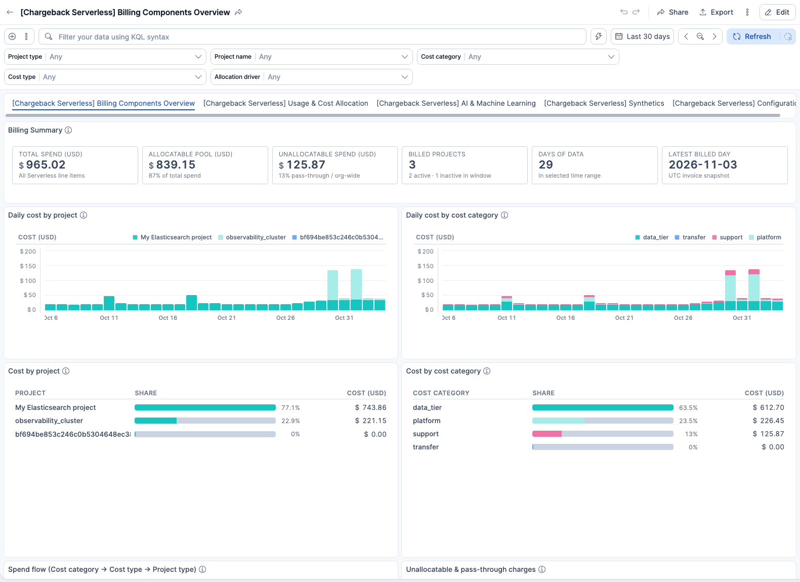
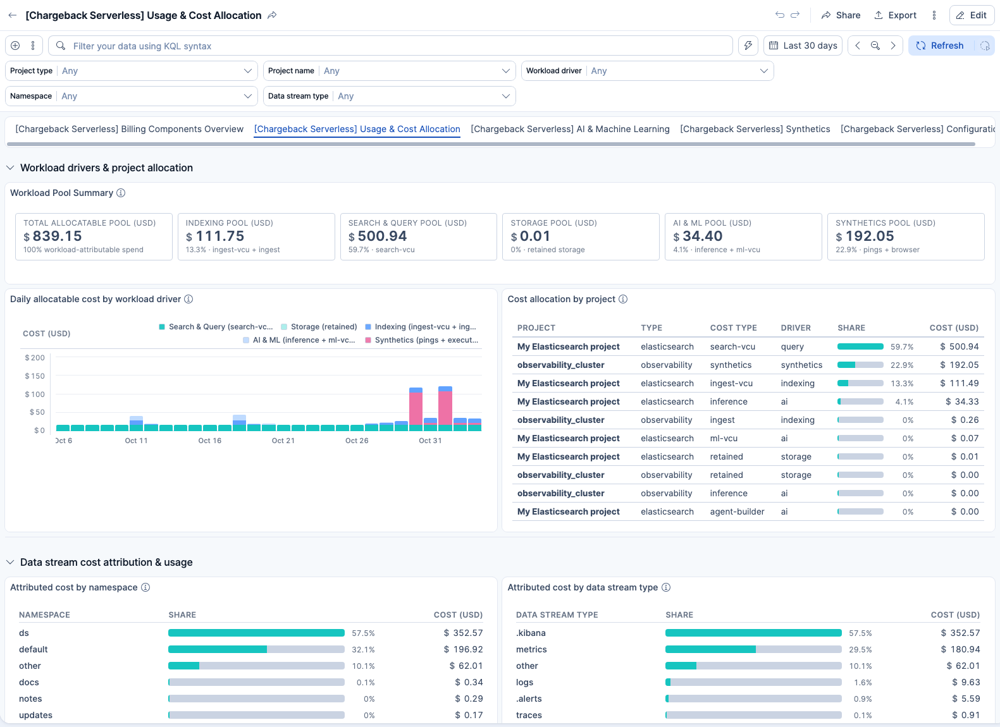
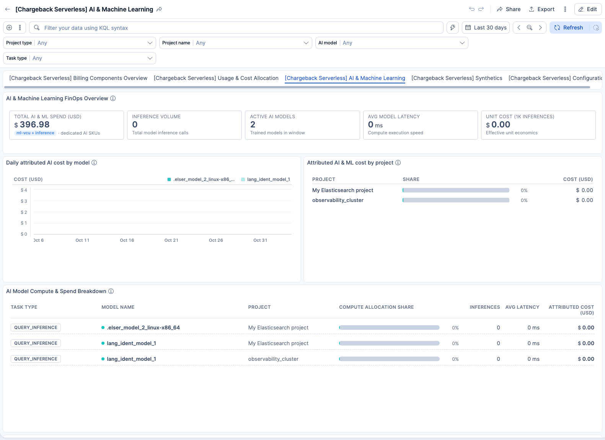
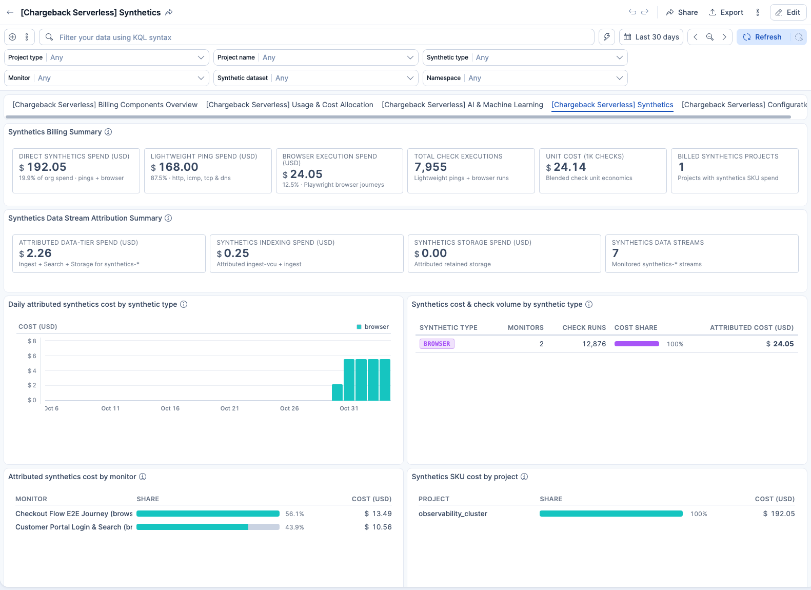
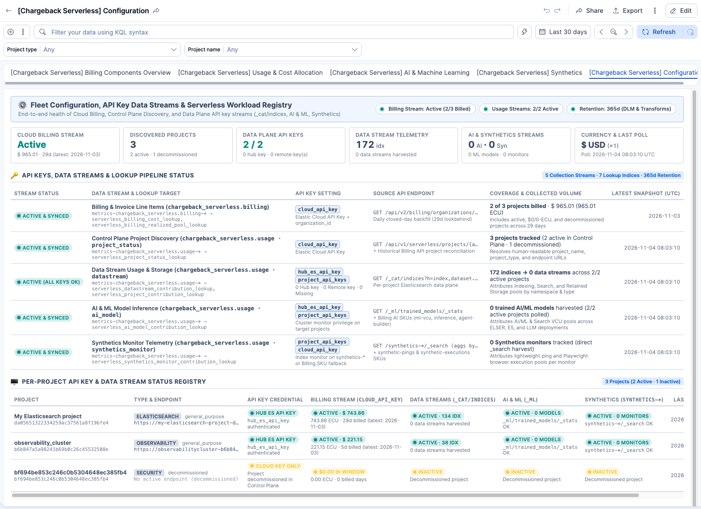

# Chargeback Serverless

_Technical preview: This integration is being developed by Elastic's Customer Engineering team. Report any issues to the Elastician who shared this integration with you._

The **Chargeback Serverless** integration allocates Elastic Cloud Serverless billing costs to **projects**, **data streams**, **namespaces**, **AI models**, and **Synthetics monitors** on an Elastic Cloud Serverless FinOps hub project.

Use this integration when your central FinOps hub runs on **Elastic Cloud Serverless**. For organization-wide billing and deployment/tier/data-stream chargeback on an Elastic Cloud Hosted or self-managed monitoring cluster, use the **Chargeback** (`chargeback`) integration (or the **Elasticsearch Service (ESS) Billing** (`ess_billing`) integration for simple organization-level billing tracking).

## Overview

- **Single unified Elastic Cloud API key (`cloud_api_key`)**: Authenticates to the Elastic Cloud Billing API (including decommissioned projects that still have billing line items in the window through `GET /api/v2/billing/organizations/{org_id}/costs/instances`), Control Plane project discovery (`/api/v1/serverless/projects`), and the Elasticsearch Data Plane (`GET /_cat/indices` to harvest index and data stream storage, indexing time, and query time) across all Serverless projects in your organization.
- **Billing classification pipelines (`metrics-chargeback_serverless.billing-<version>` and `logs-chargeback_serverless.lookup-<version>-lookup_billing`)**: Classify Elastic Cloud Serverless Stock Keeping Units (SKUs) into `allocation_driver` (`indexing`, `query`, `storage`, `ai`, `synthetics`, or `none`) and `cost_category` (`data_tier`, `platform`, `transfer`, `snapshot`, `support`, or `other`).
- **Five linked Kibana dashboards**: Reconcile organization-wide invoices, allocate workload and data stream costs, and track AI, Machine Learning (ML), Synthetics, and project harvest health using Elasticsearch Query Language (ES|QL) `LOOKUP JOIN` queries.
- **Local currency normalization**: Converts Elastic Consumption Units (ECU) into your configured currency (`conf_chargeable_unit_rate` and `conf_chargeable_unit_rate_unit`).
- **Agentless (default, beta) and Fleet-managed Elastic Agent modes**: Runs out of the box on Elastic Cloud Agentless collectors (`deployment_modes.agentless.is_default: true`) with zero infrastructure to manage, or on a customer-managed Fleet **Elastic Agent (`v9.2.0` or later)** when private proxies, custom SSL certificates, or local request tracing are required.
- **Dual data input & zero-double-counting cutover**: `billing_cost` reads both native `metrics-chargeback_serverless.billing-*` and legacy `metrics-ess_billing.billing-*`, `billing_credits` reads both native `credit_line_item` snapshots and legacy `metrics-ess_billing.credits-*`, and `ds_contrib` / `proj_contrib` read both native `metrics-chargeback_serverless.usage-*` and legacy `monitoring-indices*` (including Cross-Cluster Search `*:monitoring-indices*`), automatically preferring native streams per `(day, project_id)` bucket to prevent double-counting during migration. Opt-in compatibility aliases (`metrics-ess_billing.billing-chargeback` and `metrics-ess_billing.credits-chargeback`) can point to `serverless_billing_cost_lookup` and `serverless_billing_credits_lookup` for stock ESS Billing dashboards.
- **Dynamic configuration lookup (`serverless_chargeback_conf_lookup`)**: Continuously syncs Fleet currency unit, symbol, and ECU rate settings (`sync_fleet_config`, `config_owner_id`, `config_effective_from`) into `serverless_chargeback_conf_lookup`, or preserves manual operator updates via `POST serverless_chargeback_conf_lookup/_update/config` when Fleet sync is disabled.
- **Credit commitment tracking (`serverless_billing_credits_lookup`)**: Optionally collects organization prepaid credit commitments (`collect_ess_credits: true`) alongside legacy `metrics-ess_billing.credits-*`.
- **Project/deployment grouping (`chargeback_group:*`)**: Extracts `chargeback_group:<name>` tags into `deployment_group` for cost-center filtering and new-group detection.
- **Six alerting rule templates**: Four FinOps ES|QL alerts (30-day budget, per-project daily spend, 7-day spike, and data trust health) plus two operational alerts for newly detected `chargeback_group:*` values and `serverless_*_lookup` transform freshness monitoring.
- **Automated 365-day retention**: Enforces Data Stream Lifecycle (DLM) retention (`data_retention: "365d"`) on `metrics-chargeback_serverless.billing-*` and `metrics-chargeback_serverless.usage-*`, paired with transform `retention_policy` (`time.field: "@timestamp"`, `max_age: 365d`) across all time-series `serverless_*_lookup` destination indices (`serverless_chargeback_conf_lookup` retains active configuration without expiration).

## Before you begin

Prepare the following in your Elastic Cloud account before configuring the integration:

1. **FinOps hub project (`Elasticsearch` or `Observability Complete` on Elastic Cloud Serverless)**: Install this integration on an **Elasticsearch** Serverless project or an **Observability Complete** Serverless project (`conditions.kibana.version: "^9.6.0"` targets the evergreen Elastic Cloud Serverless stack). **Observability Logs Essentials** projects exclude `metrics` data streams (`is not allowed due to data stream type exclusions`) and cannot host the FinOps hub, though the hub monitors and attributes costs for all **Observability Logs Essentials**, **Observability Complete**, **Elasticsearch**, and **Security** projects in your organization.
2. **Collector deployment mode (Agentless default or Fleet-managed Elastic Agent `v9.2.0+`)**:
   - **Agentless (default, beta)**: No Elastic Agent host is required; Elastic Cloud runs the CEL billing and usage collectors automatically. Agent-host-only settings (`proxy_url`, `ssl`, `enable_request_tracer`) are hidden in Agentless mode. Agentless execution uses Elastic Managed integration infrastructure: this functionality is in beta and is subject to change. Beta features are not subject to the support SLA of official GA features.
   - **Fleet-managed Elastic Agent (`v9.2.0` or later)**: Use this mode if you require a private HTTP proxy, custom CA certificates, or local request tracing. Enroll a single customer-managed Fleet **Elastic Agent (`v9.2+`)** on a VM or container into your Serverless FinOps hub's Fleet Server; agents earlier than `9.2.0` are rejected at policy render time (`unsupported_agent_version`).
3. **Elastic Cloud Organization ID**: Locate your numeric organization ID in the [Elastic Cloud Console](https://cloud.elastic.co) URL or under **Organization → Settings**.
4. **Elastic Cloud API key and project harvesting credentials**: Open the [Elastic Cloud Console API keys page](https://cloud.elastic.co/deployment-features/keys) (**Organization → API keys**), click **Create API key**, and configure:
   - **Organization role**: Select **`Billing Admin`** so the Elastic Cloud Billing API returns complete organization billing history, including deleted Serverless projects.
   - **Project telemetry harvesting (choose least-privilege scoped keys or unified Cloud resource access)**:
     - **Least-privilege scoped Elasticsearch API keys (recommended for strict data-plane isolation)**: Supply read-only Elasticsearch API keys in **Hub Project Elasticsearch API Key** (`hub_es_api_key`, optionally scoped with `<project_id>:<encoded_api_key>`) and **Remote Project Elasticsearch API Keys** (`project_api_keys` in `<project_id>:<encoded_api_key>` format) scoped to cluster privileges `monitor` (`_ml/trained_models/_stats`) and `monitor_inference` (`_inference`), and index privileges `monitor` and `view_index_metadata` across `*` and `.ds-*` (including hidden backing indices for `_cat/indices`), plus `read` on `synthetics-*`.
     - **Unified Cloud API key**: Toggle **Enable access to Cloud resources** **ON**, select **All projects** (or selected projects), and configure access in the per-project-type **Roles / API Access** dropdowns for **`Elasticsearch`**, **`Observability`**, and **`Security`** (`Viewer` / `Analyst` where supported, or `Admin` if required by your organization's Cloud RBAC) to harvest all projects with a single key.

## Configure the integration

Configure your Organization ID, unified Elastic Cloud API key, lookbehind window, and currency rate in Kibana under **Management → Integrations → Chargeback Serverless → Settings**. All credentials are encrypted inside the Fleet integration policy; no API keys are stored in Elasticsearch indices.

| Setting | Secret | Purpose |
| --- | --- | --- |
| **Organization ID** | No | Numeric Elastic Cloud organization ID |
| **Elastic Cloud API Key** | Yes | Unified Elastic Cloud API key with Organization role **`Billing Admin`** and **Cloud resource access** across `Elasticsearch`, `Observability`, and `Security` project types |
| **Hub Project Elasticsearch API Key** | Yes | Optional advanced Elasticsearch API key (`hub_es_api_key`, optionally scoped as `<project_id>:<encoded_api_key>`) for harvesting local `_cat/indices` metrics on the FinOps hub project |
| **Remote Project Elasticsearch API Keys** | Yes | Optional advanced comma-separated least-privileged Elasticsearch API keys (`project_api_keys`) for remote projects in `<project_id>:<encoded_api_key>` format |
| **Billing Lookbehind Days** | No | Historical UTC days of billing data to backfill from the Elastic Cloud Billing API on initial installation (default `60`, up to `365`). Live project usage (`_cat/indices`, `_ml/trained_models/_stats`, `synthetics-*`) is collected from installation forward; any script-based historical usage backfill projects current snapshots onto past days as an estimate |
| **Currency Unit** | No | Three-letter currency code (for example, `USD`, `EUR`, or `GBP`) |
| **Currency Symbol** | No | Currency symbol displayed in KPI panels (for example, `$`, `€`, or `£`) |
| **Chargeable Unit Rate** | No | Conversion multiplier from chargeable units (ECU) to your configured currency |
| **Sync Fleet Rate Settings to Configuration Lookup** | No | Continuously sync Fleet currency unit, symbol, and ECU rate settings into `serverless_chargeback_conf_lookup` (default `true`). Disable to preserve manual updates via `POST serverless_chargeback_conf_lookup/_update/config` |
| **Configuration Owner ID (Multi-Policy)** | No | Optional identifier designating the single policy authorized to update `serverless_chargeback_conf_lookup` when multiple policies target the same hub |
| **Configuration Effective Start Date (Optional)** | No | Optional UTC day-boundary start date (`YYYY-MM-DD` or `YYYY-MM-DDT00:00:00Z`) when preserving earlier rate periods in `serverless_chargeback_conf_lookup` |
| **Collect ESS Credit Commitment Data** | No | Pull organization prepaid credit commitment line items into `metrics-chargeback_serverless.billing-*` to populate `serverless_billing_credits_lookup` (default `false`) |

The integration provisions nine continuous transforms on your FinOps hub project (`serverless_billing_cost_lookup`, `serverless_billing_credits_lookup`, `serverless_chargeback_conf_lookup`, `serverless_billing_realized_pool_lookup`, `serverless_project_status_lookup`, `serverless_project_contribution_lookup`, `serverless_datastream_contribution_lookup`, `serverless_ai_model_contribution_lookup`, and `serverless_synthetics_monitor_contribution_lookup`). All nine destination indices configure `index.mode: lookup` so dashboard panels and alerting rules can query and join configuration, project status, realized SKU pools, and project usage totals with ES|QL `LOOKUP JOIN`. All nine transforms assign sequential `_meta.order` values so Fleet installs and starts stage-1 transforms before stage-2 chained transforms (`realized_pool` reading `serverless_billing_cost_lookup-2` and `proj_contrib` reading `serverless_datastream_contribution_lookup-2`). Upgrading from `0.1.0` to `0.2.0` provisions `-2` destination indices for the seven existing transforms with updated mappings and moves the stable `serverless_*_lookup` aliases automatically via `move_on_creation: true`, allowing continuous transforms to backfill from the retained source data streams.

### Dual data input and opt-in compatibility aliases

During migrations from legacy `ess_billing` or `monitoring-indices*` pipelines, `chargeback_serverless` reads both native and legacy streams simultaneously and prefers native `chargeback_serverless.*` data per `(day, project_id)` bucket to avoid double-counting:

- **`serverless_billing_cost_lookup`**: Reads `metrics-chargeback_serverless.billing-*` and `metrics-ess_billing.billing-*` (excluding `-metrics-ess_billing.billing-chargeback` and `-serverless_*_lookup*`), populates `ess.billing.*` compatibility fields, and extracts `chargeback_group:*` tags into `deployment_group`.
- **`serverless_billing_credits_lookup`**: Reads `metrics-chargeback_serverless.billing-*` (`doc_type: credit_line_item`) and `metrics-ess_billing.credits-*` (excluding `-metrics-ess_billing.credits-chargeback`).
- **`serverless_datastream_contribution_lookup`**: Reads `metrics-chargeback_serverless.usage-*`, `monitoring-indices*`, and Cross-Cluster Search `*:monitoring-indices*` (excluding `-monitoring-indices-chargeback*` and `-serverless_*_lookup*`).
- **`serverless_project_contribution_lookup`**: Aggregates daily project totals directly from `serverless_datastream_contribution_lookup-2` so project denominators always equal the sum of selected data stream numerators, including when native and legacy streams overlap within the same project.

To power stock ESS Billing dashboards from Chargeback Serverless without running `ess_billing` in parallel, add opt-in read aliases pointing `metrics-ess_billing.billing-chargeback` to `serverless_billing_cost_lookup` and `metrics-ess_billing.credits-chargeback` to `serverless_billing_credits_lookup`.

## Dashboards

In Kibana, open **Dashboards** and filter by the **Chargeback** tag. Use the shared top navigation bar on any dashboard to switch views while preserving your active time range and filters (`Project type`, `Project name`, `Cost category`, `Cost type`, and `Allocation driver`).

### Billing Components Overview

The **`[Chargeback Serverless] Billing Components Overview`** dashboard provides organization-level invoice reconciliation across active and deleted projects:

- **Billing summary KPIs**: Total Serverless spend, allocatable workload pool, unallocatable pass-through charges, billed project counts, days of billing data, and latest UTC billing snapshot date.
- **Daily spend trends**: Daily cost stacked by project and cost category (`data_tier`, `platform`, `support`, `transfer`).
- **Spend flow and breakdown**: Multi-stage attribution flow (`cost_category` → `cost_type` → `project_type`) tracing cost origin to workload consumer.
- **Unallocatable and pass-through charges**: Visibility into non-workload charges, including support uplift, data transfer and egress, snapshots, Cross-Project Search (CPS), and Kibana Workflows executions.
- **Invoice reconciliation table**: Line-by-line SKU reconciliation comparing raw billed quantities, chargeable units (ECU), and local currency spend.

### Usage & Cost Allocation

The **`[Chargeback Serverless] Usage & Cost Allocation`** dashboard attributes allocatable SKU pools to projects, namespaces, and data streams:

- **Workload pool summary KPIs**: Dedicated KPI tiles for the Indexing pool (`ingest-vcu`), Search and Query pool (`search-vcu`), Storage pool (`retained`), AI and ML pool (`ml-vcu`), and Synthetics pool. Telemetry counters (`indexing.index_time`, `search.query_time`) harvested from `_cat/indices` are diffed against contiguous 24-hour per-backing-index cursor baselines to emit daily indexing time and daily query time deltas (`datastream_sum_indexing_time`, `datastream_sum_query_time`). Allocation divides daily VCU pools by each stream's relative daily share, with automatic proportional fallback to storage size share (`dataset.size`) on initial Day 1 baseline creation, after a collection gap exceeding 24 hours, or when daily indexing or query time across a project is zero.
- **Daily allocatable cost by workload driver**: Stacked time series tracking daily spend across indexing, search, storage, AI, and Synthetics drivers.
- **Per-project allocation breakdown**: Driver spend attributed to each Serverless project.
- **Data stream cost attribution**: Storage, ingest, and search spend broken down by namespace (`ds_namespace`), data stream type (`ds_type`), and dataset (`ds_dataset`). Standard Elastic data streams follow `<type>-<dataset>-<namespace>` (`logs`, `metrics`, `traces`, `synthetics`, and `profiling`), `.ds-.` system data streams (such as `.ds-.kibana*` and `.ds-.alerts*`) map to the `system` namespace (`ds_type: system`, `ds_namespace: system`), and standard non-data-stream Elasticsearch indices map to `ds_type: index` and `ds_namespace: default`.
- **Harvested data stream metrics**: Inventory of data streams and indices harvested through `_cat/indices`, displaying primary dataset storage size, daily indexing time delta, and daily query time delta.

### AI & Machine Learning

The **`[Chargeback Serverless] AI & Machine Learning`** dashboard tracks AI model usage and compute cost allocation:

- **AI and ML FinOps KPIs**: Total AI and ML spend (`ml-vcu` compute plus inference tokens), total inference volume, active deployed models (such as Elastic Learned Sparse EncodeR (ELSER) and language identification), average model execution latency, and unit cost per 1,000 inferences.
- **Daily attributed AI cost by model**: Daily spend trends attributed to individual trained models and inference tasks.
- **Attributed AI cost by project**: AI compute spend across projects running machine learning services.
- **AI model compute and spend breakdown**: Table of model identifier, task type (`QUERY_INFERENCE`), project, compute allocation share, inference count, latency, and attributed cost.
- **Dedicated AI billing line items**: Direct tracking of Serverless inference, managed Large Language Model (LLM), and Agent Builder SKU charges.

### Synthetics

The **`[Chargeback Serverless] Synthetics`** dashboard attributes synthetic monitoring costs across browser and lightweight monitors:

- **Synthetics billing summary KPIs**: Direct Synthetics SKU spend, lightweight ping (`observability-synthetic-pings`) versus Playwright browser execution (`observability-synthetic-executions`) split, total billed check executions, unit cost per 1,000 checks, and billed project counts.
- **Synthetics data stream attribution KPIs**: Ingest, search, and retained storage costs incurred by `synthetics-*` telemetry data streams.
- **Daily attributed Synthetics cost by type**: Daily spend by synthetic monitor type (`browser`, `http`, `icmp`, `tcp`, `dns`).
- **Attributed cost by monitor**: Spend attribution for individual synthetic monitors and multi-step browser journeys.
- **Per-monitor usage and cost attribution table**: Monitor inventory with check counts, availability (`up_count` and `down_count`), average duration, location count, and attributed cost.

### Configuration

The **`[Chargeback Serverless] Configuration`** dashboard verifies telemetry pipeline health, Fleet policy settings, and project harvest coverage:

- **Telemetry pipeline health KPIs**: Live status of the billing stream, discovered projects count, API key authentication coverage, data stream telemetry count, and active currency conversion rate.
- **Step-by-step setup guide**: Reference instructions for creating the single unified Elastic Cloud API key and configuring currency rates.
- **Per-project harvest status registry**: Paginated inventory of discovered Serverless projects detailing project type, endpoint URL, authentication key type (`cloud_key`), and harvest status across data streams, AI models, and Synthetics monitors.

## Data streams

The Chargeback Serverless integration collects two metrics data streams:

- `metrics-chargeback_serverless.billing`: Daily closed-day billing and SKU usage events from the Elastic Cloud Billing API, classified into cost categories and workload allocation drivers.
- `metrics-chargeback_serverless.usage`: Daily Serverless project status, index usage (`_cat/indices`), trained AI model metrics (`_ml/trained_models/_stats`), and Synthetics monitor runs harvested from Serverless project endpoints.

### `metrics-chargeback_serverless.billing` data stream

The `metrics-chargeback_serverless.billing` data stream collects daily closed-day billing and SKU usage line items from the Elastic Cloud Billing API and classifies each SKU into a cost category and workload allocation driver.

**Exported fields**

| Field | Description | Type |
|---|---|---|
| @timestamp | Event timestamp. | date |
| allocation_driver | Workload allocation driver (indexing, query, storage, ai, synthetics, none). | keyword |
| billing_kind | Raw billing line item resource kind from Elastic Cloud Billing API. | keyword |
| billing_type | Raw billing line item type from Elastic Cloud Billing API. | keyword |
| billing_unit | Unit of the resource being billed from Elastic Cloud Billing API. | keyword |
| cloud.account.id | Elastic Cloud organization account ID. | keyword |
| cloud.region | Cloud region where the Serverless project is deployed. | keyword |
| composite_key | Date and project ID composite key (YYYY-MM-DD_project_id). | keyword |
| conf_chargeable_unit_rate | Configured currency conversion multiplier. | double |
| conf_chargeable_unit_rate_unit | Configured currency unit label (for example USD, EUR, ZAR). | keyword |
| conf_currency_symbol | Configured currency display symbol (for example $, €, R, £). | keyword |
| conf_effective_from | Optional UTC day-boundary effective start date for configuration rate periods. | keyword |
| conf_owner_id | Optional multi-policy configuration owner identifier. | keyword |
| conf_policy_id | Stable cursor-scoped policy identifier emitted on configuration, credit commitment, and billing snapshots to isolate multi-policy agents. | keyword |
| conf_sync_enabled | Whether Fleet configuration sync is enabled on the emitting policy. | boolean |
| cost_category | High-level cost category (data_tier, platform, transfer, snapshot, support, other). | keyword |
| cost_type | Specific cost component (ingest-vcu, search-vcu, retained, ml-vcu, inference, and others). | keyword |
| credit_line_id | Identifier for an Elastic Cloud credit commitment line item. | keyword |
| data_stream.dataset | Data stream dataset. | constant_keyword |
| data_stream.namespace | Data stream namespace. | constant_keyword |
| data_stream.type | Data stream type. | constant_keyword |
| deployment_group | Chargeback group extracted from chargeback_group:\* project or deployment tags. | keyword |
| deployment_tags | Project or deployment tags used for chargeback_group:\* attribution. | keyword |
| doc_type | Event type (billing_line_item, config_snapshot, credit_line_item). | keyword |
| ess.billing.active | Whether a credit commitment line item is currently active. | boolean |
| ess.billing.ecu_balance | Remaining ECU balance on a credit commitment. | double |
| ess.billing.ecu_quantity | Total contracted ECU quantity on a credit commitment. | double |
| ess.billing.end | End timestamp of a credit commitment contract window. | date |
| ess.billing.kind | Resource kind for ESS Billing compatibility (elasticsearch, observability, security, vectordb, search). | keyword |
| ess.billing.organization_id | Elastic Cloud organization ID on credit commitment events. | keyword |
| ess.billing.start | Start timestamp of a credit commitment contract window. | date |
| ess.billing.type | Billing line item or credit commitment type (for example capacity, data_out, data_in, ingest, storage, support, usage). | keyword |
| ess.billing.unit | Unit of the resource being billed (for example, hour, GB) for ESS Billing compatibility. | keyword |
| event.ingested | Ingest pipeline execution timestamp. | date |
| group_first_seen_at | Immutable timestamp when this chargeback_group value was first observed by the billing collector. | date |
| group_initial_backfill | True when this chargeback_group value was already present during initial billing backfill. | boolean |
| input.type | Type of Filebeat input. | keyword |
| is_allocatable | True if charge is allocatable to project data streams. | boolean |
| project_id | Serverless project identifier. | keyword |
| project_name | Serverless project name. | keyword |
| project_type | Serverless project type (elasticsearch, observability, security, vectordb, search). | keyword |
| quantity_value | Raw billing quantity. | double |
| sku | Elastic Cloud billing SKU. | keyword |
| total_chargeable_units | Dual-written copy of total_ecu for ES&#124;QL compatibility. | double |
| total_ecu | Billed Elasticsearch Compute Units. | double |

### `metrics-chargeback_serverless.usage` data stream

The `metrics-chargeback_serverless.usage` data stream collects daily Serverless project harvest status, index and data stream usage (`_cat/indices`), trained AI model statistics (`_ml/trained_models/_stats`), and Synthetics monitor executions from Serverless project endpoints.

**Exported fields**

| Field | Description | Type |
|---|---|---|
| @timestamp | Event timestamp. | date |
| ai_model_count | Total number of trained AI/ML models discovered in the project. | long |
| api_key_type | API key credential type used for project harvesting (hub_key, remote_key, cloud_key, missing_key, transient_error, cloud_billing_only). | keyword |
| average_duration_ms | Average synthetic check duration in milliseconds. | double |
| average_inference_time_ms | Average latency per inference in milliseconds. | double |
| backing_index | Raw backing index or source identifier before data stream normalization. | keyword |
| check_count | Number of synthetic test check executions. | long |
| composite_key | Date and project ID composite key (YYYY-MM-DD_project_id). | keyword |
| conf_chargeable_unit_rate | Configured currency conversion multiplier. | double |
| conf_chargeable_unit_rate_unit | Configured currency unit label. | keyword |
| conf_currency_symbol | Configured currency display symbol. | keyword |
| conf_policy_id | Stable policy identifier from agent metadata to isolate multi-policy usage events. | keyword |
| data_stream.dataset | Data stream dataset. | constant_keyword |
| data_stream.namespace | Data stream namespace. | constant_keyword |
| data_stream.type | Data stream type. | constant_keyword |
| datastream | Target data stream name. | keyword |
| datastream_count | Total number of data streams aggregated in the project. | long |
| datastream_sum_data_set_store_size | Stored dataset size in bytes. | long |
| datastream_sum_indexing_time | Indexing time in milliseconds. | long |
| datastream_sum_query_time | Search query time in milliseconds. | long |
| deployment_group | Deployment cost allocation group extracted from chargeback_group tags. | keyword |
| doc_type | Event type (datastream, ai_model, synthetics_monitor, project_status). | keyword |
| down_count | Number of failed down synthetic checks. | long |
| ds_dataset | Data stream dataset name (for example http, icmp, tcp, dns, browser). | keyword |
| ds_namespace | Data stream namespace suffix. | keyword |
| ds_type | Data stream type prefix (logs, metrics, traces, synthetics, profiling, index, system, other). | keyword |
| es_url | Elasticsearch data plane endpoint URL. | keyword |
| event.ingested | Ingest pipeline execution timestamp. | date |
| index_count | Total number of indices discovered in the project. | long |
| inference_count | Number of inferences performed. | long |
| input.type | Type of Filebeat input. | keyword |
| last_status | Project harvest health status (ok, empty_or_unauthorized, transient_error, inactive). | keyword |
| locations_count | Number of distinct observer locations executing the monitor. | long |
| model_id | Trained ML model identifier. | keyword |
| monitor_id | Synthetics monitor identifier. | keyword |
| monitor_name | Synthetics monitor display name. | keyword |
| monitor_namespace | Synthetics monitor namespace. | keyword |
| monitor_type | Synthetics monitor type (http, icmp, tcp, dns, browser). | keyword |
| optimized_for | Serverless optimization profile (general_purpose, vector, and others). | keyword |
| project_id | Serverless project identifier. | keyword |
| project_name | Serverless project name. | keyword |
| project_type | Serverless project type (elasticsearch, observability, security, vectordb, search). | keyword |
| synthetics_monitor_count | Total number of Synthetics monitors discovered or attributed in the project. | long |
| synthetics_status | Synthetics telemetry harvest status (ok, billing_derived, unauthorized, transient_error, inactive). | keyword |
| task_type | Inference task type (ingest_inference, query_inference, inference, billing_derived). | keyword |
| total_duration_ms | Daily cumulative synthetic check duration in milliseconds. | double |
| total_inference_time_ms | Total compute time spent on inferences in milliseconds. | long |
| up_count | Number of successful up synthetic checks. | long |
| updated_at | Last successful harvest timestamp. | date |

## Alerting rule templates

Create alerting rules from the 6 packaged rule templates directly from **Management → Integrations → Installed integrations → Chargeback Serverless → Assets → Alerting rule templates** (or under **Stack Management → Rules → Create rule → Classic** tab). Customize thresholds and entity filters directly on **line 2** of each FinOps ES|QL rule template (`EVAL threshold_spend = <value>`):

- **`[Chargeback Serverless] Rolling 30-day total spend budget exceeded`**: Alerts when rolling 30-day spend reaches at least `threshold_pct` (default `80.0%`) of `threshold_budget` (default `25000.0`) or when `alert_on_projected` (`true`) with at least 3 billed days detects that `projected_30d_spend` (`ROUND(daily_avg_spend * 30.0, 2)`) exceeds `threshold_budget`.
- **`[Chargeback Serverless] Project daily spend threshold exceeded`**: Alerts when any project matching `filter_project` (and optional `filter_driver` in `indexing`, `search`, `storage`, `ai`, or `synthetics`) has daily spend strictly greater than `threshold_spend` (default `200.0`), outputting a full driver spend breakdown.
- **`[Chargeback Serverless] Project daily spend spike vs. 7-day baseline`**: Alerts when a project's daily spend is at least `min_daily_spend` (default `25.0`) and increases by more than `threshold_pct_increase` (default `50.0%`) over its trailing 7-day baseline average.
- **`[Chargeback Serverless] Data trust & project harvest health issue`**: Alerts when organization billing data is missing or stale (`missing_or_stale_billing_data`), any discovered active project has failed, unauthorized, or stale (`> 36` hours) usage harvesting (`stale_or_unauthorized_harvest`), a billed project is missing a human-readable name (`missing_project_name`), or unallocated spend exceeds both `threshold_unallocated_spend` (default `100.0`) and `threshold_unallocated_pct` (default `25.0%` of organization spend, `high_unallocated_spend`).
- **`[Chargeback Serverless] New chargeback group detected`**: Alerts hourly when a new non-empty `deployment_group` (`chargeback_group:*` tag) appears in `serverless_billing_cost_lookup`.
- **`[Chargeback Serverless] Transform health & lookup freshness`**: Checks hourly via an ES|QL query on `event.ingested` whether any required core lookup index (`serverless_billing_cost_lookup`, `serverless_billing_realized_pool_lookup`, `serverless_project_contribution_lookup`, `serverless_datastream_contribution_lookup`) is missing (0 documents) or stale (`> 36` hours), whether any populated optional workload lookup (`serverless_project_status_lookup`, `serverless_ai_model_contribution_lookup`, `serverless_synthetics_monitor_contribution_lookup`) has become stale (`> 36` hours), and whether `serverless_billing_credits_lookup` is missing or stale relative to active or unprocessed native (`doc_type: credit_line_item`) or legacy (`metrics-ess_billing.credits-*`) credit source events (`serverless_chargeback_conf_lookup` is a non-expiring configuration singleton).

## Supported project types

| Project type | Indexing driver | Search and query driver | Storage driver |
| --- | --- | --- | --- |
| **Elasticsearch** | Indexing time and ingest bytes (`ingest-vcu`) | Search query time (`search-vcu`) | Primary dataset size (`retained`) |
| **Elasticsearch Vector Database (`optimized_for: vector`)** | Indexing time and ingest bytes (`ingest-vcu`) | Search query time (`search-vcu`) | Primary dataset size (`retained`) |
| **Observability** | Ingest bytes and indexing time (`ingest`) | — | Primary dataset size (`retained`) |
| **Security** | Ingest bytes and indexing time (`ingest`) | — | Primary dataset size (`retained`) |
| **Search** | Indexing time and ingest bytes (`ingest-vcu`) | Search query time (`search-vcu`) | Primary dataset size (`retained`) |

## Performance and scaling

- **Agentless (default) or single customer-managed Elastic Agent policy (`v9.2+`)**: In Agentless mode, Elastic Cloud manages collector execution automatically. When using a customer-managed Fleet Elastic Agent (`v9.2.0` or later), attach the Chargeback Serverless integration to a dedicated Fleet policy with a single enrolled agent to avoid duplicate organization-wide collection runs.
- **Daily UTC cursor gating and bounded lookbehind**: Both the `billing` and `usage` Common Expression Language (CEL) streams poll on a 1-hour check interval and use persisted cursor state so each completed UTC day is collected once after `02:00 UTC`. On initial installation, `billing` backfills up to `lookbehind` days (default `60`, maximum `365`) in 1-day windows and replays a bounded 7-day trailing window once per day to capture delayed invoice adjustments.

## Troubleshooting

- **`Installation package: chargeback_serverless is not allowed due to data stream type exclusions`**: This error occurs when installing the integration on an **Observability Logs Essentials** Serverless project, which restricts `metrics` data streams in Kibana Fleet. Install the Chargeback Serverless FinOps hub on an **Elasticsearch** Serverless project or an **Observability Complete** Serverless project instead; the hub will still discover and attribute costs for all Logs Essentials and Security projects in your organization.
- **Projects report `empty_or_unauthorized` or `missing_key` on the Configuration dashboard**: Verify that your Elastic Cloud API key has **Enable access to Cloud resources** toggled **ON** across **`Elasticsearch`**, **`Observability`**, and **`Security`** project types, or provide a least-privilege project API key in `project_api_keys` (`<project_id>:<encoded_api_key>`) with `monitor` and `view_index_metadata` privileges on `*` and `.ds-*`.
- **Transforms or `LOOKUP JOIN` queries report an index mode error**: Confirm that all nine `serverless_*_lookup` destination indices are created with `"index.mode": "lookup"` and that all `logs-chargeback_serverless.*-*` transforms are in the `started` state under **Stack Management → Transforms**.

## Reference

- [Elastic Cloud Billing API documentation](https://www.elastic.co/docs/api/doc/cloud/operation/operation-get-organization-billing-costs)
- [Elastic Cloud Serverless Projects API documentation](https://www.elastic.co/docs/api/doc/cloud)
- [ES|QL `LOOKUP JOIN` documentation](https://www.elastic.co/docs/reference/query-languages/esql/esql-commands#esql-lookup-join)
