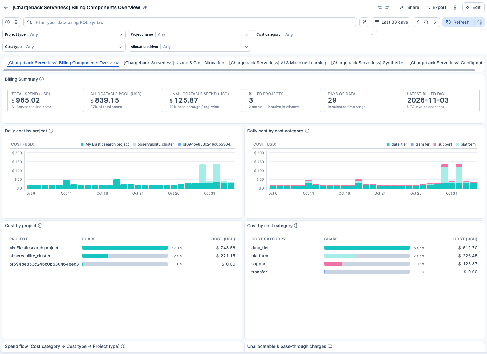
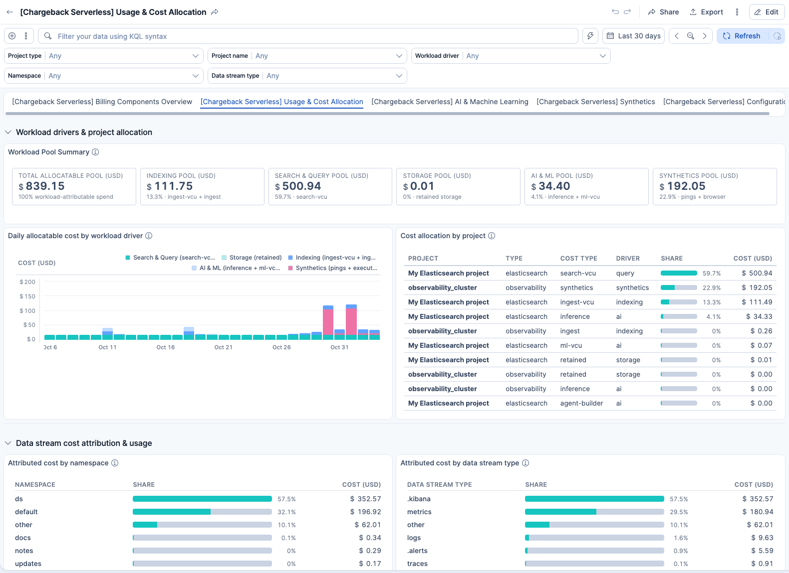
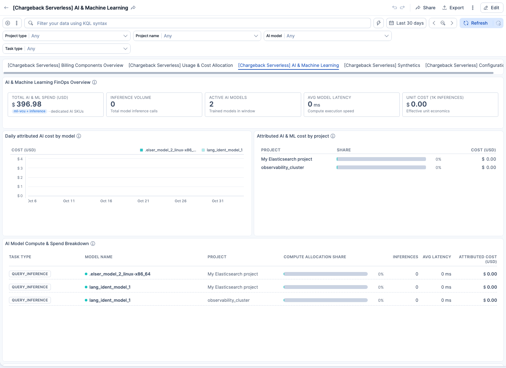
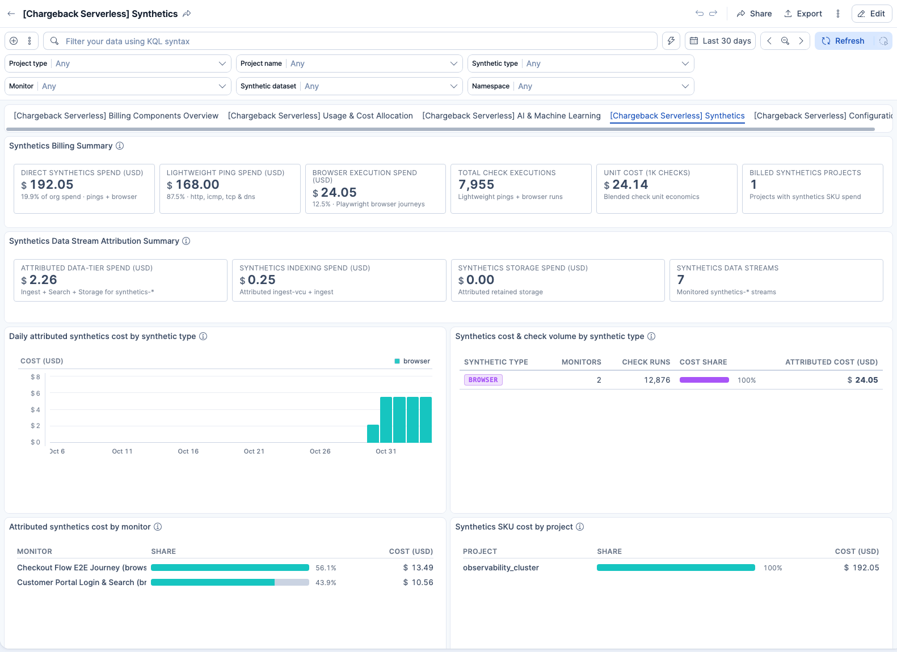
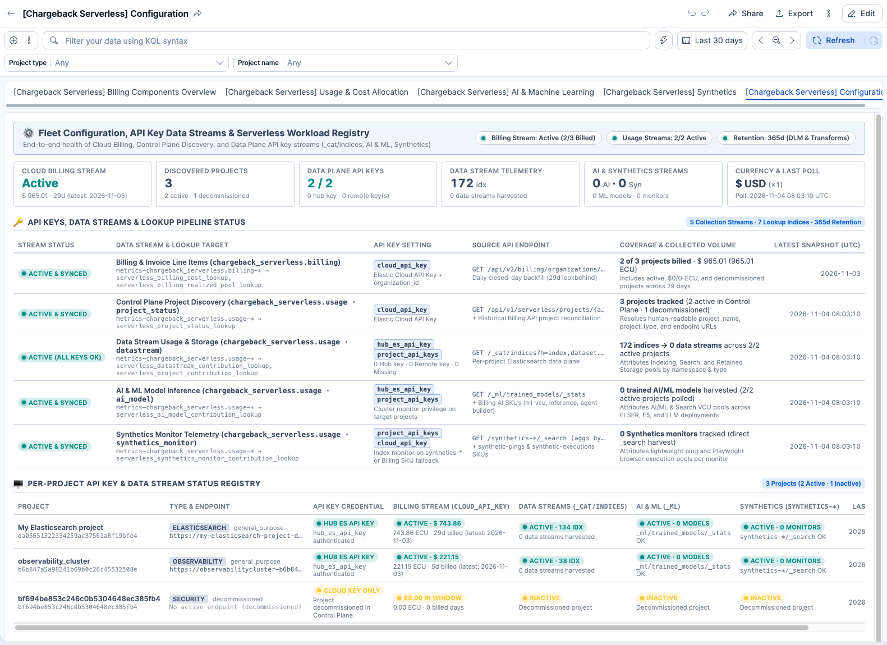

# Chargeback Serverless

The **Chargeback Serverless** integration allocates Elastic Cloud Serverless billing costs to **projects**, **data streams**, **namespaces**, **AI models**, and **Synthetics monitors** on an Elastic Cloud Serverless FinOps hub project.

Use this integration when your central FinOps hub runs on **Elastic Cloud Serverless**. If your central FinOps hub runs on an Elastic Cloud Hosted or self-managed monitoring cluster, use the `chargeback` integration with Elasticsearch Service (ESS) Billing instead.

## Overview

- **Single unified Elastic Cloud API key (`cloud_api_key`)**: Authenticates to the Elastic Cloud Billing API (including decommissioned projects that still have billing line items in the window through `GET /api/v2/billing/organizations/{org_id}/costs/instances`), Control Plane project discovery (`/api/v1/serverless/projects`), and the Elasticsearch Data Plane (`GET /_cat/indices` to harvest index and data stream storage, indexing time, and query time) across all Serverless projects in your organization.
- **Billing classification pipelines (`metrics-chargeback_serverless.billing-<version>` and `<version>-chargeback_serverless_billing`)**: Classify Elastic Cloud Serverless Stock Keeping Units (SKUs) into `allocation_driver` (`indexing`, `query`, `storage`, `ai`, `synthetics`, or `none`) and `cost_category` (`data_tier`, `platform`, `transfer`, `snapshot`, `support`, or `other`).
- **Five linked Kibana dashboards**: Reconcile organization-wide invoices, allocate workload and data stream costs, and track AI, Machine Learning (ML), Synthetics, and project harvest health using Elasticsearch Query Language (ES|QL) `LOOKUP JOIN` queries.
- **Local currency normalization**: Converts Elastic Consumption Units (ECU) into your configured currency (`conf_chargeable_unit_rate` and `conf_chargeable_unit_rate_unit`).
- **Four FinOps alerting rule templates**: Prebuilt ES|QL alerting rules aligned with Elastic Cloud `costs_alerting` patterns for rolling 30-day organization spend budget (with watermark percentage and projected 30-day overrun detection), per-project daily spend (with optional workload driver filter and driver breakdown), 7-day project daily spend spike detection, and data trust health checks.
- **Automated 365-day retention**: Enforces Data Stream Lifecycle (DLM) retention (`data_retention: "365d"`) on `metrics-chargeback_serverless.billing-*` and `metrics-chargeback_serverless.usage-*`, paired with transform `retention_policy` (`time.field: "@timestamp"`, `max_age: 365d`) across all seven `serverless_*_lookup` destination indices.

## Before you begin

Prepare the following in your Elastic Cloud account before configuring the integration:

1. **Elastic Cloud Organization ID**: Locate your numeric organization ID in the [Elastic Cloud Console](https://cloud.elastic.co) URL or under **Organization → Settings**.
2. **Elastic Cloud API key and project harvesting credentials**: Open the [Elastic Cloud Console API keys page](https://cloud.elastic.co/deployment-features/keys) (**Organization → API keys**), click **Create API key**, and configure:
   - **Organization role**: Select **`Billing Admin`** so the Elastic Cloud Billing API returns complete organization billing history, including deleted Serverless projects.
   - **Project telemetry harvesting (choose least-privilege scoped keys or unified Cloud resource access)**:
     - **Least-privilege scoped Elasticsearch API keys (recommended for strict data-plane isolation)**: Supply read-only Elasticsearch API keys in **Hub Project Elasticsearch API Key** (`hub_es_api_key`) and **Remote Project Elasticsearch API Keys** (`project_api_keys` in `<project_id>:<encoded_api_key>` format) scoped to cluster privilege `monitor` (`_cat/indices`, `_ml/trained_models/_stats`) and index privilege `read` / `view_index_metadata` on `synthetics-*`.
     - **Unified Cloud API key**: Toggle **Enable access to Cloud resources** **ON**, select **All projects** (or selected projects), and configure access in the per-project-type **Roles / API Access** dropdowns for **`Elasticsearch`**, **`Observability`**, and **`Security`** (`Viewer` / `Analyst` where supported, or `Admin` if required by your organization's Cloud RBAC) to harvest all projects with a single key.

## Configure the integration

Configure your Organization ID, unified Elastic Cloud API key, lookbehind window, and currency rate in Kibana under **Management → Integrations → Chargeback Serverless → Settings**. All credentials are encrypted inside the Fleet integration policy; no API keys are stored in Elasticsearch indices.

| Setting | Secret | Purpose |
| --- | --- | --- |
| **Organization ID** | No | Numeric Elastic Cloud organization ID |
| **Elastic Cloud API Key** | Yes | Unified Elastic Cloud API key with Organization role **`Billing Admin`** and **Cloud resource access** across `Elasticsearch`, `Observability`, and `Security` project types |
| **Hub Project Elasticsearch API Key** | Yes | Optional advanced Elasticsearch API key (`hub_es_api_key`) for harvesting local `_cat/indices` metrics on the FinOps hub project |
| **Remote Project Elasticsearch API Keys** | Yes | Optional advanced comma-separated least-privileged Elasticsearch API keys (`project_api_keys`) for remote projects in `<project_id>:<encoded_api_key>` format |
| **Billing Lookbehind Days** | No | Historical UTC days of billing data to backfill on initial installation (default `60`) |
| **Currency Unit** | No | Three-letter currency code (for example, `USD`, `EUR`, or `GBP`) |
| **Currency Symbol** | No | Currency symbol displayed in KPI panels (for example, `$`, `€`, or `£`) |
| **Chargeable Unit Rate** | No | Conversion multiplier from chargeable units (ECU) to your configured currency |

The integration provisions seven continuous transforms on your FinOps hub project (`serverless_billing_cost_lookup`, `serverless_billing_realized_pool_lookup`, `serverless_project_status_lookup`, `serverless_project_contribution_lookup`, `serverless_datastream_contribution_lookup`, `serverless_ai_model_contribution_lookup`, and `serverless_synthetics_monitor_contribution_lookup`). All seven destination indices configure `index.mode: lookup` so dashboard panels and alerting rules can query and join project status, realized SKU pools, and project usage totals with ES|QL `LOOKUP JOIN`.

## Dashboards

In Kibana, open **Dashboards** and filter by the **Chargeback** tag. Use the shared top navigation bar on any dashboard to switch views while preserving your active time range and filters (`Project type`, `Project name`, `Cost category`, `Cost type`, and `Allocation driver`).

### Billing Components Overview

The **`[Chargeback Serverless] Billing Components Overview`** dashboard provides organization-level invoice reconciliation across active and deleted projects:

- **Billing summary KPIs**: Total Serverless spend, allocatable workload pool, unallocatable pass-through charges, billed project counts, days of billing data, and latest UTC billing snapshot date.
- **Daily spend trends**: Daily cost stacked by project and cost category (`data_tier`, `platform`, `support`, `transfer`).
- **Spend flow and breakdown**: Multi-stage attribution flow (`cost_category` → `cost_type` → `project_type`) tracing cost origin to workload consumer.
- **Unallocatable and pass-through charges**: Visibility into non-workload charges, including support uplift, data transfer and egress, snapshots, Cross-Project Search (CPS), and Kibana Workflows executions.
- **Invoice reconciliation table**: Line-by-line SKU reconciliation comparing raw billed quantities, chargeable units (ECU), and local currency spend.

### Usage & Cost Allocation

The **`[Chargeback Serverless] Usage & Cost Allocation`** dashboard attributes allocatable SKU pools to projects, namespaces, and data streams:

- **Workload pool summary KPIs**: Dedicated KPI tiles for the Indexing pool (`ingest-vcu`), Search and Query pool (`search-vcu`), Storage pool (`retained`), AI and ML pool (`ml-vcu`), and Synthetics pool. Telemetry counters (`indexing.index_time`, `search.query_time`) harvested via `_cat/indices` are cumulative lifetime counters per backing index; allocation divides daily VCU pools by each stream's relative share, with automatic proportional fallback to storage size share (`dataset.size`) when indexing or query time across a project is zero.
- **Daily allocatable cost by workload driver**: Stacked time series tracking daily spend across indexing, search, storage, AI, and Synthetics drivers.
- **Per-project allocation breakdown**: Driver spend attributed to each Serverless project.
- **Data stream cost attribution**: Storage, ingest, and search spend broken down by namespace (`ds_namespace`), data stream type (`ds_type`), and dataset (`ds_dataset`). Standard Elastic data streams follow `<type>-<dataset>-<namespace>` (`logs`, `metrics`, `traces`, `synthetics`, and `profiling`), `.ds-.` system data streams (such as `.ds-.kibana*` and `.ds-.alerts*`) map to the `system` namespace (`ds_type: system`, `ds_namespace: system`), and standard non-data-stream Elasticsearch indices map to `ds_type: index` and `ds_namespace: default`.
- **Harvested data stream metrics**: Inventory of data streams and indices harvested through `_cat/indices`, displaying primary dataset storage size, cumulative indexing time, and cumulative query time.

### AI & Machine Learning

The **`[Chargeback Serverless] AI & Machine Learning`** dashboard tracks AI model usage and compute cost allocation:

- **AI and ML FinOps KPIs**: Total AI and ML spend (`ml-vcu` compute plus inference tokens), total inference volume, active deployed models (such as Elastic Learned Sparse EncodeR (ELSER) and language identification), average model execution latency, and unit cost per 1,000 inferences.
- **Daily attributed AI cost by model**: Daily spend trends attributed to individual trained models and inference tasks.
- **Attributed AI cost by project**: AI compute spend across projects running machine learning services.
- **AI model compute and spend breakdown**: Table of model identifier, task type (`QUERY_INFERENCE`), project, compute allocation share, inference count, latency, and attributed cost.
- **Dedicated AI billing line items**: Direct tracking of Serverless inference, managed Large Language Model (LLM), and Agent Builder SKU charges.

### Synthetics

The **`[Chargeback Serverless] Synthetics`** dashboard attributes synthetic monitoring costs across browser and lightweight monitors:

- **Synthetics billing summary KPIs**: Direct Synthetics SKU spend, lightweight ping (`observability-synthetic-pings`) versus Playwright browser execution (`observability-synthetic-executions`) split, total billed check executions, unit cost per 1,000 checks, and billed project counts.
- **Synthetics data stream attribution KPIs**: Ingest, search, and retained storage costs incurred by `synthetics-*` telemetry data streams.
- **Daily attributed Synthetics cost by type**: Daily spend by synthetic monitor type (`browser`, `http`, `icmp`, `tcp`, `dns`).
- **Attributed cost by monitor**: Spend attribution for individual synthetic monitors and multi-step browser journeys.
- **Per-monitor usage and cost attribution table**: Monitor inventory with check counts, availability (`up_count` and `down_count`), average duration, location count, and attributed cost.

### Configuration

The **`[Chargeback Serverless] Configuration`** dashboard verifies telemetry pipeline health, Fleet policy settings, and project harvest coverage:

- **Telemetry pipeline health KPIs**: Live status of the billing stream, discovered projects count, API key authentication coverage, data stream telemetry count, and active currency conversion rate.
- **Step-by-step setup guide**: Reference instructions for creating the single unified Elastic Cloud API key and configuring currency rates.
- **Per-project harvest status registry**: Paginated inventory of discovered Serverless projects detailing project type, endpoint URL, authentication key type (`cloud_key`), and harvest status across data streams, AI models, and Synthetics monitors.

## Data streams

The Chargeback Serverless integration collects two metrics data streams:

- `metrics-chargeback_serverless.billing`: Daily closed-day billing and SKU usage events from the Elastic Cloud Billing API, classified into cost categories and workload allocation drivers.
- `metrics-chargeback_serverless.usage`: Daily Serverless project status, index usage (`_cat/indices`), trained AI model metrics (`_ml/trained_models/_stats`), and Synthetics monitor runs harvested from Serverless project endpoints.

### `metrics-chargeback_serverless.billing` data stream

The `metrics-chargeback_serverless.billing` data stream collects daily closed-day billing and SKU usage line items from the Elastic Cloud Billing API and classifies each SKU into a cost category and workload allocation driver.

**Exported fields**

| Field | Description | Type |
|---|---|---|
| @timestamp | Event timestamp. | date |
| allocation_driver | Workload allocation driver (indexing, query, storage, none). | keyword |
| composite_key | Date and project ID composite key (YYYY-MM-DD_project_id). | keyword |
| conf_chargeable_unit_rate | Configured currency conversion multiplier. | double |
| conf_chargeable_unit_rate_unit | Configured currency unit label (for example USD, EUR, ZAR). | keyword |
| conf_currency_symbol | Configured currency display symbol (for example $, €, R, £). | keyword |
| cost_category | High-level cost category (data_tier, platform, transfer, snapshot, support, other). | keyword |
| cost_type | Specific cost component (ingest-vcu, search-vcu, retained, ml-vcu, inference, and others). | keyword |
| data_stream.dataset | Data stream dataset. | constant_keyword |
| data_stream.namespace | Data stream namespace. | constant_keyword |
| data_stream.type | Data stream type. | constant_keyword |
| event.ingested | Ingest pipeline execution timestamp. | date |
| is_allocatable | True if charge is allocatable to project data streams. | boolean |
| project_id | Serverless project identifier. | keyword |
| project_name | Serverless project name. | keyword |
| project_type | Serverless project type (elasticsearch, observability, security). | keyword |
| quantity_value | Raw billing quantity. | double |
| sku | Elastic Cloud billing SKU. | keyword |
| total_chargeable_units | Dual-written copy of total_ecu for ES|QL compatibility. | double |
| total_ecu | Billed Elasticsearch Compute Units. | double |

### `metrics-chargeback_serverless.usage` data stream

The `metrics-chargeback_serverless.usage` data stream collects daily Serverless project harvest status, index and data stream usage (`_cat/indices`), trained AI model statistics (`_ml/trained_models/_stats`), and Synthetics monitor executions from Serverless project endpoints.

**Exported fields**

| Field | Description | Type |
|---|---|---|
| @timestamp | Event timestamp. | date |
| ai_model_count | Total number of trained AI/ML models discovered in the project. | long |
| api_key_type | API key credential type used for project harvesting (hub_key, remote_key, missing_key, cloud_billing_only). | keyword |
| average_duration_ms | Average synthetic check duration in milliseconds. | double |
| average_inference_time_ms | Average latency per inference in milliseconds. | double |
| backing_index | Raw backing index or source identifier before data stream normalization. | keyword |
| check_count | Number of synthetic test check executions. | long |
| composite_key | Date and project ID composite key (YYYY-MM-DD_project_id). | keyword |
| conf_chargeable_unit_rate | Configured currency conversion multiplier. | double |
| conf_chargeable_unit_rate_unit | Configured currency unit label. | keyword |
| conf_currency_symbol | Configured currency display symbol. | keyword |
| data_stream.dataset | Data stream dataset. | constant_keyword |
| data_stream.namespace | Data stream namespace. | constant_keyword |
| data_stream.type | Data stream type. | constant_keyword |
| datastream | Target data stream name. | keyword |
| datastream_count | Total number of data streams aggregated in the project. | long |
| datastream_sum_data_set_store_size | Stored dataset size in bytes. | long |
| datastream_sum_indexing_time | Indexing time in milliseconds. | long |
| datastream_sum_query_time | Search query time in milliseconds. | long |
| doc_type | Event type (datastream, ai_model, synthetics_monitor, project_status). | keyword |
| down_count | Number of failed down synthetic checks. | long |
| ds_dataset | Data stream dataset name (for example http, icmp, tcp, dns, browser). | keyword |
| ds_namespace | Data stream namespace suffix. | keyword |
| ds_type | Data stream type prefix (logs, metrics, traces, synthetics, other). | keyword |
| es_url | Elasticsearch data plane endpoint URL. | keyword |
| event.ingested | Ingest pipeline execution timestamp. | date |
| index_count | Total number of indices discovered in the project. | long |
| inference_count | Number of inferences performed. | long |
| last_status | Project harvest health status (ok, empty_or_unauthorized, inactive). | keyword |
| locations_count | Number of distinct observer locations executing the monitor. | long |
| model_id | Trained ML model identifier. | keyword |
| monitor_id | Synthetics monitor identifier. | keyword |
| monitor_name | Synthetics monitor display name. | keyword |
| monitor_namespace | Synthetics monitor namespace. | keyword |
| monitor_type | Synthetics monitor type (http, icmp, tcp, dns, browser). | keyword |
| optimized_for | Serverless optimization profile (general_purpose, vector, and others). | keyword |
| project_id | Serverless project identifier. | keyword |
| project_name | Serverless project name. | keyword |
| project_type | Serverless project type (elasticsearch, observability, security). | keyword |
| synthetics_monitor_count | Total number of Synthetics monitors discovered or attributed in the project. | long |
| synthetics_status | Synthetics telemetry harvest status (ok, billing_derived, unauthorized, inactive). | keyword |
| task_type | Inference task type (ingest_inference, query_inference). | keyword |
| total_inference_time_ms | Total compute time spent on inferences in milliseconds. | long |
| up_count | Number of successful up synthetic checks. | long |
| updated_at | Last successful harvest timestamp. | date |

## Alerting rule templates

Create alerting rules from the 4 packaged ES|QL rule templates under **Stack Management → Rules**. Customize thresholds and entity filters directly on **line 2** of each rule template's ES|QL query (`EVAL threshold_spend = <value>`):

- **`[Chargeback Serverless] Rolling 30-day total spend budget exceeded`**: Alerts when rolling 30-day spend reaches `threshold_pct` (default `80.0%`) of `threshold_budget` (default `25000.0`) or when `alert_on_projected` (`true`) detects that projected 30-day spend (`daily_run_rate * 30`) will exceed `threshold_budget`.
- **`[Chargeback Serverless] Project daily spend threshold exceeded`**: Alerts when any project matching `filter_project` (and optional `filter_driver` in `indexing`, `search`, `storage`, `ai`, or `synthetics`) exceeds `threshold_spend` (default `200.0`), outputting a full driver spend breakdown.
- **`[Chargeback Serverless] Project daily spend spike vs. 7-day baseline`**: Alerts when a project's daily spend increases by at least `threshold_pct_increase` (default `50.0%`) over its 7-day trailing average and exceeds `min_daily_spend` (default `25.0`).
- **`[Chargeback Serverless] Data trust & project harvest health issue`**: Alerts when any discovered Serverless project fails usage harvesting or unallocated spend exceeds `threshold_unallocated_spend` (default `100.0`) and `threshold_unallocated_pct` (default `25.0%`).

## Supported project types

| Project type | Indexing driver | Search and query driver | Storage driver |
| --- | --- | --- | --- |
| **Elasticsearch** | Indexing time and ingest bytes (`ingest-vcu`) | Search query time (`search-vcu`) | Primary dataset size (`retained`) |
| **Elasticsearch Vector Database (`optimized_for: vector`)** | Indexing time and ingest bytes (`ingest-vcu`) | Search query time (`search-vcu`) | Primary dataset size (`retained`) |
| **Observability** | Ingest bytes and indexing time (`ingest`) | — | Primary dataset size (`retained`) |
| **Security** | Ingest bytes and indexing time (`ingest`) | — | Primary dataset size (`retained`) |
