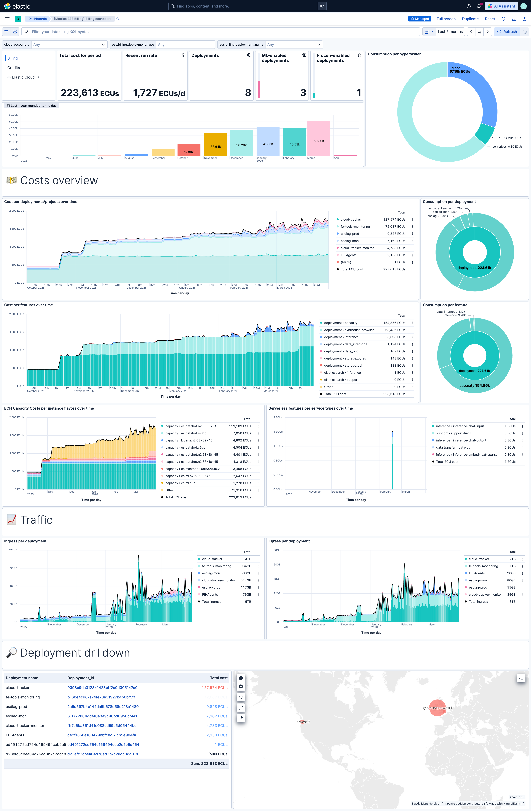
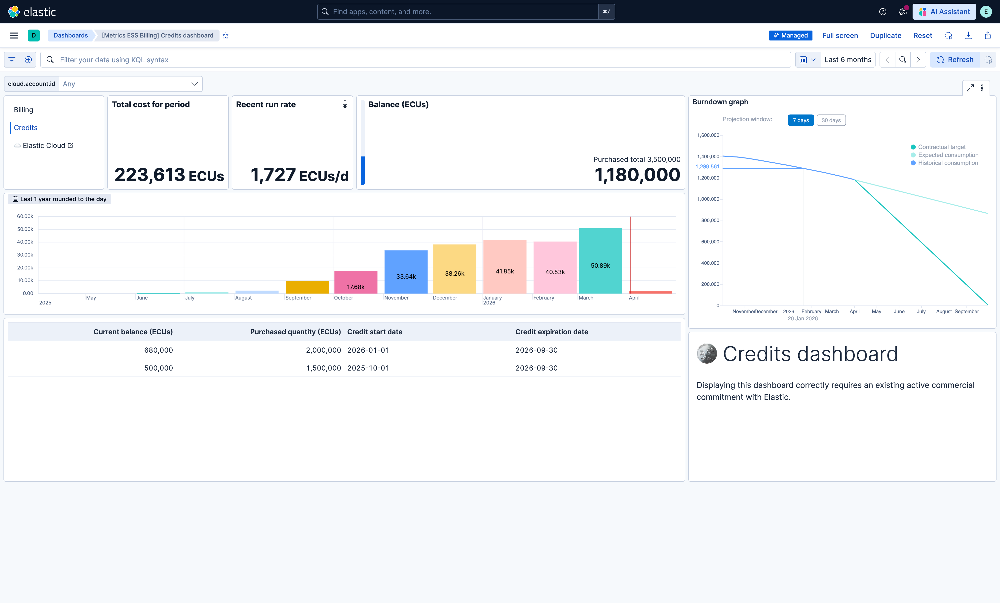

# Elasticsearch Service Billing

The Elasticsearch Service Billing integration (also known as the **Elastic Cloud billing integration**) lets you monitor usage and costs for your entire **Elastic Cloud organization**. It collects billing data from the [Elastic Cloud Billing API](https://www.elastic.co/docs/api/doc/cloud-billing/), normalizes daily cost and usage rows to the [FinOps Open Cost and Usage Specification (FOCUS) 1.4](https://focus.finops.org/docs/specification/v1-4/), and sends them to your target Elasticsearch cluster. Dashboards are provided out-of-the-box to help you visualize spending across your organization.

Using this integration, you could for instance create alerts whenever a new deployment or project is created, when your baseline spending exceeds a threshold, or export FOCUS-compliant rows directly to your FinOps platform.

## Supported Elastic Cloud products

This integration reports **organization-level** billing data. Any usage billed to your Elastic Cloud organization appears in the collected data, regardless of deployment model.

| Product | What is billed | How it appears in billing data |
| --- | --- | --- |
| **Elastic Cloud Hosted** | Deployments (Elasticsearch, Kibana, and add-on capacity), data transfer, snapshot storage, and related services | Resources with `ResourceType: deployment` |
| **Elastic Cloud Serverless** | Serverless projects (Elasticsearch, Observability, and Security), including usage-based dimensions such as ingest, retention, and search power | Resources with `ResourceType` values such as `elasticsearch`, `observability`, or `security` |
| **Cloud connected usage** | Elastic Cloud services consumed through [Cloud Connect](https://www.elastic.co/docs/deploy-manage/cloud-connect) on self-managed, ECE, or ECK clusters (for example, [Elastic Inference Service](https://www.elastic.co/docs/explore-analyze/elastic-inference/eis) token usage) | Organization-level line items for connected services |
| **Other Elastic Cloud services** | Add-on services billed to the organization (for example, Synthetics monitors) | Service-specific line items alongside deployments and projects |

Usage is metered in [Elastic Consumption Units (ECUs)](https://www.elastic.co/docs/deploy-manage/cloud-organization/billing/ecu) (`PricingCurrency: ECU`, recorded in `PricingCurrencyEffectiveCost`) and converted to USD (`BillingCurrency: USD`) across the FOCUS cost columns (`ListCost`, `ContractedCost`, `EffectiveCost`, and `BilledCost`).

## Data streams

The Elasticsearch Service Billing integration collects the following data streams:

* Your daily cost and usage in the `metrics-ess_billing.cost_and_usage` data stream, stored as FOCUS 1.4 Cost and Usage rows.
* For customers with a yearly commitment with Elastic, your credit status in the `metrics-ess_billing.credit` data stream.

By default, the last year of billing data is collected upon first execution of the integration. The data is then collected daily, and the integration automatically collects the latest data every day.

## Requirements

You need Elasticsearch for storing and searching your data and Kibana for visualizing and managing it.
This integration collects data at the organization level, so there is no need to target individual deployments or projects.

You will need the identifier of your Elastic Cloud **organization** (not a single deployment or project), which can be seen on the [cloud organization page](https://cloud.elastic.co/account/members).

You will also need to provision an API key with the `Billing admin` role on the [API keys page](https://cloud.elastic.co/account/keys). This key must have access to the organization whose billing data you want to collect.

For private cloud, or admin users, the cloud endpoint can be altered to match your requirements. You can change this in the "advanced settings" section of the integration configuration.

## Setup

For step-by-step instructions on how to set up an integration, see the
[Getting started](https://www.elastic.co/docs/solutions/observability/get-started/quickstart-monitor-hosts-with-elastic-agent) guide.

If you run on Elastic Cloud (Hosted or Serverless), this integration is available as an [Elastic Managed integration](https://www.elastic.co/docs/manage-data/ingest/managed-integrations/managed-integrations). When an Elastic Managed integration is available, you don't need to install an Elastic Agent to gather these metrics. This functionality is in beta and is subject to change. Beta features are not subject to the support SLA of official GA features.

### FOCUS settings

The `cost_and_usage` stream includes the following settings to populate FOCUS 1.4 billing and pricing columns:

* **Purchase channel** (`purchase_channel`): How this organization buys Elastic Cloud (`direct`, `gcp_marketplace`, `aws_marketplace`, or `azure_marketplace`; default `direct`). For cloud marketplace purchases, the cloud provider issues the invoice, so `BilledCost` is `0` and `InvoiceIssuerName` is set to the cloud provider (`Google Cloud`, `Amazon Web Services`, or `Microsoft`). This avoids double-counting spend when combined with your cloud provider's own FOCUS dataset, while `ContractedCost`, `EffectiveCost`, and `PricingCurrencyEffectiveCost` continue to reflect your Elastic Cloud consumption.
* **Contracted price of one ECU (USD)** (`contracted_ecu_rate`, advanced): Price of one Elastic Consumption Unit in your contract in USD (default `"1.0"` for list price; invalid values are treated as `1.0`). Used to calculate `ContractedUnitPrice`, `ContractedCost`, `EffectiveCost`, and (for direct purchases) `BilledCost`. `ListUnitPrice` and `ListCost` always use the `1.00` USD list price.
* **Billing account name** (`billing_account_name`, advanced): Display name of the Elastic Cloud organization for `BillingAccountName`. When empty, `BillingAccountId` (the organization ID) is used.
* **Add deployment tags** (`add_deployment_tags`, advanced): When enabled, deployment tags are stored both as a FOCUS JSON object string in `Tags` and as `key:value` entries in `x_DeploymentTags` for filtering and Chargeback allocation.

## Upgrading from 1.x

Version `2.0.0` replaces the `metrics-ess_billing.billing` data stream and `ess.billing.*` fields with `metrics-ess_billing.cost_and_usage` using FOCUS 1.4 Cost and Usage column names:

* **Automatic backfill:** Upgrading creates `metrics-ess_billing.cost_and_usage-*` and collects historical billing data from the Elastic Cloud Billing API for your configured lookbehind period (`365d` by default).
* **Existing indices:** Old `metrics-ess_billing.billing-*` indices are not deleted automatically. Update custom saved searches, dashboards, alerts, transforms, and exports to read from `metrics-ess_billing.cost_and_usage-*` and the new fields below, then delete `metrics-ess_billing.billing-*` when no longer needed.
* **Marketplace organizations:** Set **Purchase channel** in the integration policy when upgrading. Rows collected before changing this setting carry the `direct` default (`InvoiceIssuerName: "Elastic"`).
* **Chargeback integration:** Upgrade the Chargeback integration alongside `ess_billing` `2.0.0` so its transforms query `metrics-ess_billing.cost_and_usage-*`.

| 1.x field | 2.0 field(s) | Notes |
| --- | --- | --- |
| `ess.billing.organization_id` | `BillingAccountId`, `BillingAccountName` | `BillingAccountName` uses the **Billing account name** setting, or `BillingAccountId` when empty |
| `ess.billing.deployment_id` | `ResourceId` | Elasticsearch resource ID for Hosted deployments |
| `ess.billing.deployment_name` | `ResourceName` | Omitted when the billing API returns an empty name (Serverless) |
| `ess.billing.deployment_type` | `ResourceType` | `deployment` for Hosted; project type for Serverless |
| `ess.billing.deployment_tags` | `Tags`, `x_DeploymentTags` | `Tags` is a JSON object string; `x_DeploymentTags` preserves `key:value` terms |
| `ess.billing.sku` | `SkuPriceId`, `SkuId`, `SkuPriceDetails.x_SubscriptionLevel` | `SkuId` holds the pricing-table SKU |
| `ess.billing.ram_per_zone` | `SkuPriceDetails.MemorySize` | Converted from MB per zone to GiB |
| `ess.billing.zone_count` | `SkuPriceDetails.x_ZoneCount` | Number of availability zones |
| `cloud.machine.type` | `SkuPriceDetails.InstanceType`, `cloud.machine.type` | Both populated |
| `ess.billing.type` | `SkuMeter` | Billing dimension (for example, `capacity` or `data_transfer`) |
| `ess.billing.name` | `ChargeDescription` | Line-item description from the billing API |
| `ess.billing.kind` | `ServiceName`, `ServiceCategory`, `ServiceSubcategory` | Mapped to FOCUS service taxonomy |
| `ess.billing.from` | `ChargePeriodStart`, `BillingPeriodStart`, `@timestamp` | `BillingPeriodStart` is the start of the calendar month |
| `ess.billing.to` | `ChargePeriodEnd`, `BillingPeriodEnd` | Exclusive end timestamps |
| `ess.billing.quantity.value` | `ConsumedQuantity`, `PricingQuantity` | Metered quantity |
| `ess.billing.unit` | `ConsumedUnit`, `PricingUnit` | Unit of measure as returned by the billing API |
| `ess.billing.rate.value` | `PricingCurrencyListUnitPrice`, `PricingCurrencyContractedUnitPrice`, `ListUnitPrice`, `ContractedUnitPrice` | `PricingCurrency*` in ECU; `ListUnitPrice` and `ContractedUnitPrice` in USD |
| `ess.billing.total_ecu` | `PricingCurrencyEffectiveCost`, `ListCost`, `ContractedCost`, `EffectiveCost`, `BilledCost` | `PricingCurrencyEffectiveCost` in ECU; USD cost columns (`BilledCost: 0` for marketplace) |
| `ess.billing.cloud.service.type` | `x_ServerlessServiceType` | Serverless SKUs only |
| `ess.billing.quantity.formatted_value`, `ess.billing.rate.formatted_value`, `ess.billing.display_quantity.*` | Dropped | Display strings derivable from numeric quantity, rate, and unit |

## Data streams reference

### `metrics-ess_billing.cost_and_usage` data stream

The `metrics-ess_billing.cost_and_usage` data stream collects daily billing line items from the Elastic Cloud Billing API and stores each event as a FOCUS 1.4 Cost and Usage row (`x_FocusVersion: "1.4"`). Line items represent an Elastic Cloud Hosted deployment, a Serverless project, a cloud connected service, or another organization-level service (for example, Synthetics monitors).

For Serverless projects, `ResourceType` reflects the project type (for example, `observability` or `security`). For Hosted deployments, `ResourceType` is `deployment`, and `ResourceId` contains the ID of the deployment's Elasticsearch resource, as returned by the billing API. This is not the deployment ID shown in the Elastic Cloud console. Use `ResourceName` to identify the deployment.

An example event for `cost_and_usage` looks as following:

```json
{
    "@timestamp": "2026-11-25T00:00:00.000Z",
    "BilledCost": 0,
    "BillingAccountId": "1111",
    "BillingAccountName": "Example Organization",
    "BillingCurrency": "USD",
    "BillingPeriodEnd": "2026-12-01T00:00:00.000Z",
    "BillingPeriodStart": "2026-11-01T00:00:00.000Z",
    "ChargeCategory": "Usage",
    "ChargeDescription": "Cloud Standard, AWS us-east-1 (N. Virginia), aws.es.datafrozen.i3en.2, 4GB, 1AZ",
    "ChargeFrequency": "Usage-Based",
    "ChargePeriodEnd": "2026-11-26T00:00:00.000Z",
    "ChargePeriodStart": "2026-11-25T00:00:00.000Z",
    "ConsumedQuantity": 24,
    "ConsumedUnit": "hour",
    "ContractedCost": 2.31936,
    "ContractedUnitPrice": 0.09664,
    "EffectiveCost": 2.31936,
    "HostProviderName": "Amazon Web Services",
    "InvoiceIssuerName": "Google Cloud",
    "ListCost": 2.8992,
    "ListUnitPrice": 0.1208,
    "PricingCategory": "Standard",
    "PricingCurrency": "ECU",
    "PricingCurrencyContractedUnitPrice": 0.1208,
    "PricingCurrencyEffectiveCost": 2.8992,
    "PricingCurrencyListUnitPrice": 0.1208,
    "PricingQuantity": 24,
    "PricingUnit": "hour",
    "RegionId": "us-east-1",
    "RegionName": "us-east-1",
    "ResourceId": "4679751e171d403d8603cb1639b67e57",
    "ResourceName": "example-deployment",
    "ResourceType": "deployment",
    "ServiceCategory": "Analytics",
    "ServiceName": "Elasticsearch",
    "ServiceProviderName": "Elastic",
    "ServiceSubcategory": "Search",
    "SkuId": "aws.es.datafrozen.i3en.2",
    "SkuMeter": "capacity",
    "SkuPriceDetails": {
        "InstanceType": "aws.es.datafrozen.i3en.2",
        "MemorySize": 4,
        "x_ZoneCount": 1
    },
    "SkuPriceId": "aws.es.datafrozen.i3en.2_us-east-1_4096_1",
    "agent": {
        "ephemeral_id": "9d84baa5-4fbb-4a7a-8e52-df69fd247d77",
        "id": "0c0dba96-f709-4786-8b12-f3df56c7b98d",
        "name": "elastic-agent-61245",
        "type": "filebeat",
        "version": "9.4.3"
    },
    "cloud": {
        "account": {
            "id": "1111"
        },
        "geo": {
            "location": {
                "coordinates": [
                    -77.03690000809729,
                    38.907199990935624
                ],
                "type": "Point"
            },
            "name": "us-east-1"
        },
        "instance": {
            "id": "4679751e171d403d8603cb1639b67e57",
            "name": "example-deployment"
        },
        "machine": {
            "type": "es.datafrozen.i3en.2"
        },
        "provider": "aws",
        "region": "us-east-1"
    },
    "data_stream": {
        "dataset": "ess_billing.cost_and_usage",
        "namespace": "74855",
        "type": "metrics"
    },
    "ecs": {
        "version": "8.0.0"
    },
    "elastic_agent": {
        "id": "0c0dba96-f709-4786-8b12-f3df56c7b98d",
        "snapshot": false,
        "version": "9.4.3"
    },
    "event": {
        "agent_id_status": "verified",
        "created": "2026-11-27T06:04:36.374Z",
        "dataset": "ess_billing.cost_and_usage",
        "ingested": "2026-11-27T06:04:39Z",
        "module": "ess_billing"
    },
    "input": {
        "type": "cel"
    },
    "labels": {
        "test_run_id": "50068"
    },
    "tags": [
        "billing",
        "forwarded"
    ],
    "x_ContractedEcuRate": 0.8,
    "x_FocusVersion": "1.4",
    "x_PurchaseChannel": "gcp_marketplace",
    "x_ZeroRated": false
}
```

**Exported fields**

| Field | Description | Type |
|---|---|---|
| @timestamp | Event timestamp. Start of the charge period. | date |
| BilledCost | Charge that is the basis for invoicing, in the billing currency. Equal to `ContractedCost` for a direct purchase, 0 for a cloud marketplace purchase because the marketplace invoices the charge. | double |
| BillingAccountId | ID of the Elastic Cloud organization. | keyword |
| BillingAccountName | Display name of the billing account, from the Billing account name setting. The organization ID when the setting is empty. | keyword |
| BillingCurrency | Currency of the cost columns. ECU amounts are reported as USD, at the nominal value of 1.00 USD for one ECU. | keyword |
| BillingPeriodEnd | Start of the next calendar month, exclusive, UTC. | date |
| BillingPeriodStart | Start of the calendar month of the charge, inclusive, UTC. | date |
| ChargeCategory | Highest-level classification of the charge. Always `Usage`. | keyword |
| ChargeClass | Null: the billing API does not report corrections to closed billing periods. | keyword |
| ChargeDescription | Description of the billed SKU, as returned by the billing API. | keyword |
| ChargeFrequency | How often the charge occurs. Always `Usage-Based`. | keyword |
| ChargePeriodEnd | End of the day of the billing line item, exclusive, UTC. | date |
| ChargePeriodStart | Start of the day of the billing line item, inclusive, UTC. | date |
| ConsumedQuantity | Quantity of the line item, from the billing API. | double |
| ConsumedUnit | Unit of measure of `ConsumedQuantity`, as returned by the billing API. | keyword |
| ContractedCost | Cost in ECU multiplied by the contracted ECU price, in the billing currency. | double |
| ContractedUnitPrice | Unit price in ECU multiplied by the contracted ECU price, in the billing currency. | double |
| EffectiveCost | Cost after all reduced rates and discounts, in the billing currency. Equal to `ContractedCost`. | double |
| HostProviderName | Provider of the infrastructure that hosts the resource. Elastic for services that are not tied to one cloud provider. | keyword |
| InvoiceIssuerName | Entity responsible for invoicing the charge. Elastic for a direct purchase, the cloud provider for a marketplace purchase. | keyword |
| ListCost | Cost in ECU at the list price of one ECU (1.00 USD), in the billing currency. | double |
| ListUnitPrice | Unit price in ECU at the list price of one ECU (1.00 USD), in the billing currency. | double |
| PricingCategory | Pricing model of the charge. Always `Standard`. | keyword |
| PricingCurrency | Currency of the price list. Always `ECU`. | keyword |
| PricingCurrencyContractedUnitPrice | Unit price applied by the billing API, in ECU. | double |
| PricingCurrencyEffectiveCost | Cost of the charge in ECU. | double |
| PricingCurrencyListUnitPrice | Unit price applied by the billing API, in ECU. | double |
| PricingQuantity | Quantity of the line item, from the billing API. | double |
| PricingUnit | Unit of measure of `PricingQuantity`, as returned by the billing API. | keyword |
| RegionId | Region of the resource, or `global` for services that are not tied to a region. Null when the billing API reports no region. | keyword |
| RegionName | Name of the region. Equal to `RegionId`. | keyword |
| ResourceId | ID of the billed instance, as reported by the billing API. For Hosted deployments this is the ID of the Elasticsearch resource. Null for organization-level charges. | keyword |
| ResourceName | Name of the billed deployment or project. | keyword |
| ResourceType | Type of the billed instance. `deployment` for Hosted deployments, the project type for Serverless projects. | keyword |
| ServiceCategory | Highest-level FOCUS classification of the service. | keyword |
| ServiceName | Name of the Elastic Cloud service that the SKU belongs to. | keyword |
| ServiceProviderName | Provider of the service. Always `Elastic`. | keyword |
| ServiceSubcategory | Secondary FOCUS classification of the service. | keyword |
| SkuId | SKU as listed in the Elastic Cloud pricing table, without subscription level, region, memory and zone count. | keyword |
| SkuMeter | Type of usage that the SKU measures, as returned by the billing API. | keyword |
| SkuPriceDetails.InstanceType | Instance configuration of a capacity SKU. | keyword |
| SkuPriceDetails.MemorySize | Memory per zone of a capacity SKU, in GiB. | double |
| SkuPriceDetails.x_SubscriptionLevel | Subscription level encoded in the billing SKU. | keyword |
| SkuPriceDetails.x_ZoneCount | Number of availability zones of a capacity SKU. | long |
| SkuPriceId | Billing SKU that identifies one unit price, as returned by the billing API. | keyword |
| Tags | Deployment tags as a serialized JSON object with sorted keys, for example \{"team":"search"\}. Requires the Add deployment tags setting. | keyword |
| cloud.account.id |  | keyword |
| data_stream.dataset | Data stream dataset. | constant_keyword |
| data_stream.namespace | Data stream namespace. | constant_keyword |
| data_stream.type | Data stream type. | constant_keyword |
| event.module | Event module | constant_keyword |
| input.type |  | keyword |
| x_ContractedEcuRate | Price of one ECU in the billing currency used for the contracted and effective costs of the row. | double |
| x_DeploymentTags | Deployment tags as "key:value" terms, as collected. Used for filtering and by the Chargeback integration. | keyword |
| x_FocusVersion | Version of the FOCUS specification that the row follows. | keyword |
| x_PurchaseChannel | How the organization buys Elastic Cloud, from the Purchase channel setting (direct, gcp_marketplace, aws_marketplace or azure_marketplace). | keyword |
| x_ServerlessServiceType | Service part of a Serverless SKU, for example the project type. | keyword |
| x_ZeroRated | True when the unit price is zero, which marks a free SKU. | boolean |




### `metrics-ess_billing.credit` data stream

The `metrics-ess_billing.credit` data stream collects credit data from the Elastic Cloud Billing API. This is only available for customers with a direct yearly or multi-year contract with Elastic (not marketplace or monthly subscriptions). ECU credits apply to all Elastic Cloud usage in the organization, including Hosted, Serverless, and cloud connected services.

An example event for `credits` looks as following:

```json
{
    "@timestamp": "2025-01-29T15:57:57.368Z",
    "agent": {
        "ephemeral_id": "3fefd74f-7a64-4bad-82e8-6c226de5d333",
        "id": "bb84ef9e-6cd6-4177-822a-b3a0f05644f3",
        "name": "docker-fleet-agent",
        "type": "filebeat",
        "version": "8.17.0"
    },
    "cloud": {
        "account": {
            "id": "12345678"
        }
    },
    "data_stream": {
        "dataset": "ess_billing.credits",
        "namespace": "default",
        "type": "metrics"
    },
    "ecs": {
        "version": "8.0.0"
    },
    "elastic_agent": {
        "id": "bb84ef9e-6cd6-4177-822a-b3a0f05644f3",
        "snapshot": false,
        "version": "8.17.0"
    },
    "ess": {
        "billing": {
            "active": false,
            "ecu_balance": 1463000,
            "ecu_quantity": 1463000,
            "start": "2025-07-01T00:00:00.000Z",
            "end": "2026-06-30T23:59:59.999Z",
            "organization_id": "12345678",
            "type": "prepaid_consumption"
        }
    },
    "event": {
        "agent_id_status": "verified",
        "dataset": "ess_billing.credits",
        "ingested": "2025-01-29T15:57:58Z"
    },
    "input": {
        "type": "cel"
    },
    "tags": [
        "billing",
        "forwarded"
    ]
}
```

**Exported fields**

| Field | Description | Type |
|---|---|---|
| @timestamp | Event timestamp. | date |
| cloud.account.id |  | keyword |
| data_stream.dataset | Data stream dataset. | constant_keyword |
| data_stream.namespace | Data stream namespace. | constant_keyword |
| data_stream.type | Data stream type. | constant_keyword |
| ess.billing.active | Whether the credit line is active. | boolean |
| ess.billing.ecu_balance | Balance of Elastic Consumption Units (ECUs) in the credit line. | long |
| ess.billing.ecu_quantity | Initially purchased quantity of Elastic Consumption Units (ECUs) in the credit line. | long |
| ess.billing.end | End date of the credit line. | date |
| ess.billing.organization_id | ID of the organization in Elastic Cloud. | keyword |
| ess.billing.start | Start date of the credit line. | date |
| ess.billing.type | Type of the credit line. | keyword |
| input.type |  | keyword |



