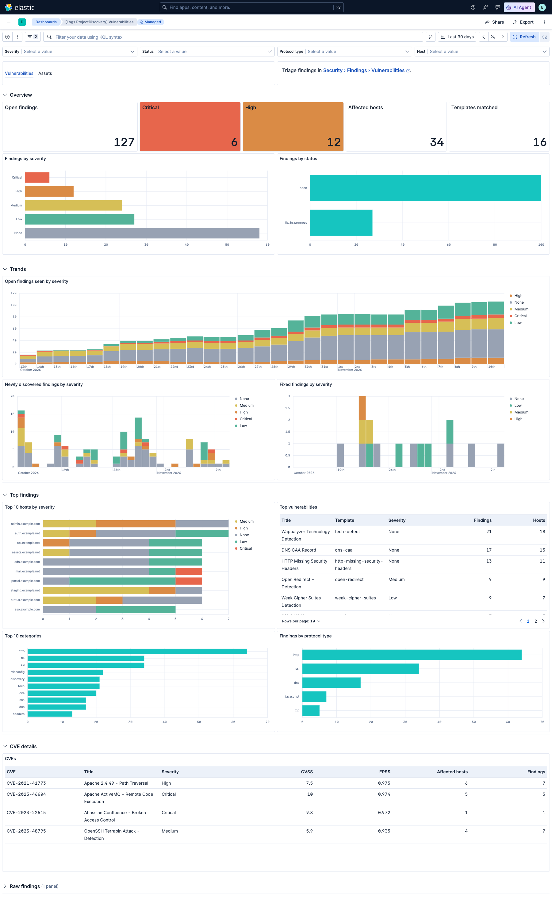
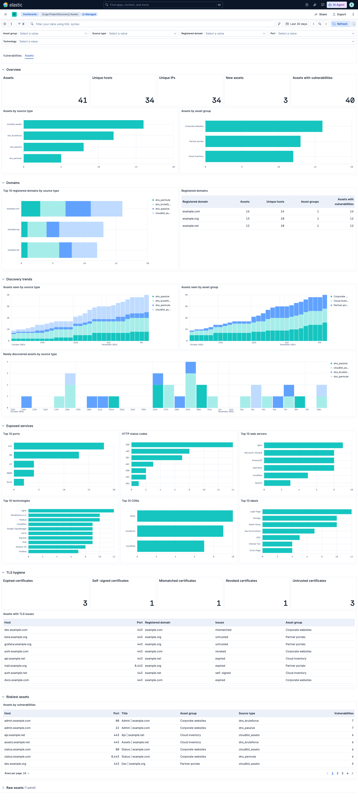

<!-- NOTICE: Do not edit this file manually.-->
<!-- This file is automatically generated by Elastic Package -->
# ProjectDiscovery Integration for Elastic

## Overview

The ProjectDiscovery integration for Elastic collects vulnerability findings and asset inventory from [ProjectDiscovery Cloud Platform](https://cloud.projectdiscovery.io) (PDCP). PDCP runs [Nuclei](https://github.com/projectdiscovery/nuclei) scans against your external attack surface and keeps an inventory of the assets it discovers.

### Compatibility

This integration supports the ProjectDiscovery Cloud Platform REST API (`https://api.projectdiscovery.io`, `v1` endpoints). It requires Kibana 9.5.0 or later.

### How it works

The integration uses the [CEL input](https://www.elastic.co/docs/reference/beats/filebeat/filebeat-input-cel) to poll the PDCP API on a schedule.

- The `vulnerability` data stream pages through scan results that are sorted by `updated_at` and stores the newest timestamp it has seen as its cursor.
- The `asset` data stream pages through the asset enumeration contents in the same way.

Each data stream saves its cursor only after a full pass has finished. If a pass is interrupted, it starts again from the previous cursor, so no data is lost, but some events can be duplicated.

Two transforms keep the latest state of each finding and each asset in lookup mode indices. Fixed, false positive, duplicate and accepted risk findings are excluded from the latest vulnerability index. You can enrich findings with asset context by using an ES|QL `LOOKUP JOIN`.

## What data does this integration collect?

The ProjectDiscovery integration collects the following types of data:

* `vulnerability`: Nuclei findings from `GET /v1/scans/results`, including the template metadata, classification (CVE, CWE, CVSS, EPSS), the vulnerability status and the metadata of the affected asset.
* `asset`: Discovered assets from `GET /v1/asset/enumerate/contents`, including hosts, IPs, autonomous systems, ports, technologies, TLS certificates and cloud provider. Assets are ingested as entities (`event.kind: asset`, `entity.*`).

### Supported use cases

- Track exposed vulnerabilities in your external attack surface alongside your other security data.
- Find vulnerabilities in the Elastic Security Findings page by using the `security_solution-projectdiscovery.vulnerability_latest` index. The **Data source** field of the findings flyout links to the Nuclei template that detected the finding (`vulnerability.data_source.*`).
- Enrich findings with asset context (host, IP, technologies, TLS, cloud provider) by using ES|QL `LOOKUP JOIN`.
- Monitor remediation progress through the ProjectDiscovery vulnerability status (`open`, `fixed`, `false_positive`, and others) in `logs-projectdiscovery.vulnerability-*`. The latest vulnerability index excludes resolved and dismissed findings.
- Group findings and assets by root domain with `server.registered_domain`. For example, `codebox.example.co.uk` results in `example.co.uk`.
- Group findings and assets by network owner with `server.as.number` and `server.as.organization.name`.

### Dashboards

The integration includes two dashboards. Both are built with ES|QL and share dashboard controls that filter every panel, including the raw data panel:

- **[Logs ProjectDiscovery] Vulnerabilities**: Current open findings by severity, status, host, category, and protocol type; trends of findings seen, newly discovered, and fixed; CVE details with CVSS and EPSS scores; and the raw findings. Controls filter on severity, status, protocol type, and host.
- **[Logs ProjectDiscovery] Assets**: The asset inventory by source type, asset group, and registered domain; discovery trends; exposed services (ports, HTTP status codes, web servers, technologies, CDNs, and labels); TLS hygiene; the riskiest assets; and the raw assets. Controls filter on asset group, source type, registered domain, port, and technology.





Trend panels count distinct findings or assets per time bucket on `@timestamp`, which ProjectDiscovery updates on every rescan. A finding or asset therefore appears in each bucket in which it was seen, not only when it was first discovered.

### Root domain fields

Both data streams split the host name (`host.name`, or `url.domain` when the host name is missing or is not a domain name) into `server.domain`, `server.registered_domain`, `server.subdomain` and `server.top_level_domain`. The split uses the public suffix list, so multi-part suffixes such as `co.uk` are handled correctly. IP addresses and names without a public suffix do not populate these fields.

## What do I need to use this integration?

- A ProjectDiscovery Cloud Platform account with access to the team whose data you want to collect.
- A ProjectDiscovery API key and the Team ID.
- An Elastic deployment with Kibana 9.4.0 or later.

## How do I deploy this integration?

### Agent-based deployment

Elastic Agent must be installed. For more details, check the Elastic Agent [installation instructions](https://www.elastic.co/guide/en/fleet/current/elastic-agent-installation.html). You can install only one Elastic Agent per host.

Elastic Agent is required to poll the ProjectDiscovery API and ship the data to Elastic, where the events are processed by the integration's ingest pipelines.

### Agentless deployment

Agentless deployments are only supported in Elastic Serverless and Elastic Cloud environments. Agentless deployments provide a means to ingest data while avoiding the orchestration, management, and maintenance needs associated with standard ingest infrastructure. Using an agentless deployment makes manual agent deployment unnecessary, allowing you to focus on your data instead of the agent that collects it.

For more information, refer to [Agentless integrations](https://www.elastic.co/guide/en/serverless/current/security-agentless-integrations.html) and [Agentless integrations FAQ](https://www.elastic.co/guide/en/serverless/current/agentless-integration-troubleshooting.html).

### Set up steps in ProjectDiscovery

1. Recommended: an Owner or Admin of the team invites a dedicated integration user with the **Viewer** role under **Settings → Team**. The Viewer role can read every endpoint this integration uses.
2. Sign in as that user and go to **Settings → API Key** (<https://cloud.projectdiscovery.io/settings/api-key>). Copy the API key.
3. In **Settings → Team** (<https://cloud.projectdiscovery.io/settings/team>), copy the **Team ID** of the team workspace.

API keys have no scopes. A key acts with the team role of the user who owns it.

#### Vendor resources

- [ProjectDiscovery API introduction](https://docs.projectdiscovery.io/api-reference/introduction)
- [Team administration and roles](https://docs.projectdiscovery.io/cloud/admin)

### Set up steps in Kibana

1. In Kibana, go to **Management → Integrations** and search for **ProjectDiscovery**.
2. Click **Add ProjectDiscovery**.
3. Configure the integration settings:
   - **API URL**: The ProjectDiscovery API base URL. The default is `https://api.projectdiscovery.io`.
   - **API Key**: The API key copied from ProjectDiscovery. It is sent in the `X-API-Key` header.
   - **Team ID**: The Team ID copied from ProjectDiscovery. It is sent in the `X-Team-Id` header and is normally required to collect team data.
   - **HTTP Client Timeout**, **Proxy URL** and **SSL Configuration**: Optional HTTP client settings.
4. Configure each data stream:
   - **Interval**: How often to poll the API. The defaults are `15m` for vulnerabilities and `1h` for assets.
   - **Initial Interval**: How far back to collect data on the first run, based on `updated_at`. The default is `720h` (30 days). If your tenant has not been scanned recently, increase this value. Otherwise, the first run collects nothing.
   - **Batch Size**: The number of records to request per page (maximum 100).
   - **Severity** (vulnerability only): The severities to collect. The default includes `info`. Remove `info` to reduce the volume by about 90%.
5. Click **Save and continue**.

### Validation

1. In Kibana, go to **Discover** and select the `logs-*` data view.
2. Filter on `data_stream.dataset : "projectdiscovery.vulnerability"` or `data_stream.dataset : "projectdiscovery.asset"`.
3. Confirm that events appear. Events with `error.message` indicate API or decoding errors.
4. Go to **Stack Management → Transforms** and check that the `logs-projectdiscovery.latest_cdr_vulnerabilities-*` and `logs-projectdiscovery.latest_asset-*` transforms are started and healthy.
5. Go to **Dashboards** and open **[Logs ProjectDiscovery] Vulnerabilities** and **[Logs ProjectDiscovery] Assets**. Trend panels need data in more than one time bucket. Right after setup, select a shorter time range, such as the last 24 hours, if they show no results.

## Troubleshooting

- No data is collected on the first run: The default `720h` initial interval only covers findings and assets updated in the last 30 days. Increase **Initial Interval** if your last scan is older.
- Empty **Package** column in the Findings page: The integration sets `package.name` from the template metadata product or the CPE product. Most Nuclei findings (misconfiguration, TLS and header checks) have neither.
- A finding is missing from the latest index or the Findings page: The `latest_cdr_vulnerabilities` transform excludes findings whose `projectdiscovery.vulnerability.vuln_status` is `fixed`, `false_positive`, `duplicate` or `accepted_risk`. All statuses are still available in `logs-projectdiscovery.vulnerability-*`.
- A fixed finding is still shown as open in the latest index: Because resolved findings are excluded from the transform source, the previous state of a finding that changes from `open` to `fixed` is not replaced. It is removed when it is older than the 90 day retention period (based on `@timestamp`).
- The Findings flyout has an empty **Vulnerability Score** section: This section only displays CVSS vectors attributed to NVD, Red Hat or GHSA (`vulnerability.cvss.*`). Nuclei templates don't state the source of their CVSS data, so the integration doesn't populate these fields. The **CVSS** badge in the flyout header shows the template score from `vulnerability.score.base` and `vulnerability.score.version`.
- Assets disappear from the latest index: The `latest_asset` transform removes assets that have not been seen for 3 days (based on `entity.last_seen_timestamp`). This matches the asset expiry rules of ProjectDiscovery.
- HTTP 401 or 403 errors: Check the API key, and check that its user is a member of the team in **Team ID**.
- HTTP 429 errors: ProjectDiscovery limits requests per minute. The integration throttles requests and retries with backoff. If errors persist, increase **Interval** or check whether other API clients share the same key.
- Missing team data: Check that **Team ID** is set to the team workspace that holds your scans and assets.

## Performance and scaling

- Every ProjectDiscovery rescan updates `updated_at` on every finding it detects again, so each scan cycle re-sends the whole active set of findings. With `info` severity, a large tenant can take several hours to collect a full cycle at the vulnerability API limit of 60 requests per minute. Removing `info` from **Severity** reduces this to minutes.
- The asset API is limited to 30 requests per minute. The integration requests at most one page every two seconds.
- Run only one integration policy per ProjectDiscovery team. Multiple policies share the same rate limit.

For more information on architectures that can be used for scaling this integration, check the [Ingest Architectures](https://www.elastic.co/docs/manage-data/ingest/ingest-reference-architectures) documentation.

## Reference

### Inputs used

These inputs can be used with this integration:
<details>
<summary>cel</summary>

## Setup

For more details about the CEL input settings, check the [Filebeat documentation](https://www.elastic.co/guide/en/beats/filebeat/current/filebeat-input-cel.html).

Before configuring the CEL input, make sure you have:
- Network connectivity to the target API endpoint
- Valid authentication credentials (API keys, tokens, or certificates as required)
- Appropriate permissions to read from the target data source

### Collecting logs from CEL

To configure the CEL input, you must specify the `request.url` value pointing to the API endpoint. The interval parameter controls how frequently requests are made and is the primary way to balance data freshness with API rate limits and costs. Authentication is often configured through the `request.headers` section using the appropriate method for the service.

NOTE: To access the API service, make sure you have the necessary API credentials and that the Filebeat instance can reach the endpoint URL. Some services may require IP whitelisting or VPN access.

To collect logs via API endpoint, configure the following parameters:

- API Endpoint URL
- API credentials (tokens, keys, or username/password)
- Request interval (how often to fetch data)
</details>


### API usage

These APIs are used with this integration:

* [Get all results](https://docs.projectdiscovery.io/api-reference/results/get-all-results) (`GET /v1/scans/results`): Vulnerability findings.
* [Get all enumeration contents](https://docs.projectdiscovery.io/api-reference/enumerations/get-all-enumeration-contents) (`GET /v1/asset/enumerate/contents`): Asset inventory.

### Vendor documentation links

- [ProjectDiscovery Cloud Platform](https://docs.projectdiscovery.io/cloud/introduction)
- [Asset discovery overview](https://docs.projectdiscovery.io/cloud/assets/overview)
- [Nuclei](https://docs.projectdiscovery.io/opensource/nuclei/running)

### Latest indices and asset enrichment

The integration installs two transforms:

| Transform | Destination alias | Unique key | Retention |
|---|---|---|---|
| `latest_cdr_vulnerabilities` | `security_solution-projectdiscovery.vulnerability_latest` | `event.id`, `data_stream.namespace` | 90 days on `@timestamp`. Fixed, false positive, duplicate and accepted risk findings are excluded. |
| `latest_asset` | `logs-projectdiscovery_latest.asset` | `event.dataset`, `entity.id` | 3 days on `entity.last_seen_timestamp` |

Both destination indices use lookup mode, so you can join them in ES|QL. Findings reference their asset through `projectdiscovery.vulnerability.asset_metadata.id`, which matches `entity.id` in the asset index.

`LOOKUP JOIN` replaces every column that also exists in the lookup index, including `@timestamp`, `event.*`, `host.*`, `server.*`, `url.*`, `tls.*` and `cloud.*`. When no asset matches, these columns become `null`. Copy the finding columns you need under new names and keep only those before the join:

```esql
FROM logs-projectdiscovery.vulnerability-*
| WHERE projectdiscovery.vulnerability.asset_metadata.id IS NOT NULL
| EVAL finding.timestamp = @timestamp, finding.id = event.id, entity.id = projectdiscovery.vulnerability.asset_metadata.id
| KEEP finding.timestamp, finding.id, entity.id, vulnerability.id, vulnerability.severity, projectdiscovery.vulnerability.vuln_status
| LOOKUP JOIN logs-projectdiscovery_latest.asset ON entity.id
| KEEP finding.timestamp, finding.id, vulnerability.id, vulnerability.severity, projectdiscovery.vulnerability.vuln_status, entity.id, entity.name, entity.type, host.ip
```

### Data streams

#### vulnerability

The `vulnerability` data stream provides Nuclei vulnerability findings from ProjectDiscovery Cloud Platform.

##### vulnerability fields

**Exported fields**

| Field | Description | Type |
|---|---|---|
| @timestamp | Date/time when the event originated. This is the date/time extracted from the event, typically representing when the event was generated by the source. If the event source has no original timestamp, this value is typically populated by the first time the event was received by the pipeline. Required field for all events. | date |
| cloud.provider | Name of the cloud provider. Example values are aws, azure, gcp, or digitalocean. | keyword |
| data_stream.dataset | The field can contain anything that makes sense to signify the source of the data. Examples include `nginx.access`, `prometheus`, `endpoint` etc. For data streams that otherwise fit, but that do not have dataset set we use the value "generic" for the dataset value. `event.dataset` should have the same value as `data_stream.dataset`. Beyond the Elasticsearch data stream naming criteria noted above, the `dataset` value has additional restrictions:   \* Must not contain `-`   \* No longer than 100 characters | constant_keyword |
| data_stream.namespace | A user defined namespace. Namespaces are useful to allow grouping of data. Many users already organize their indices this way, and the data stream naming scheme now provides this best practice as a default. Many users will populate this field with `default`. If no value is used, it falls back to `default`. Beyond the Elasticsearch index naming criteria noted above, `namespace` value has the additional restrictions:   \* Must not contain `-`   \* No longer than 100 characters | constant_keyword |
| data_stream.type | An overarching type for the data stream. Currently allowed values are "logs" and "metrics". We expect to also add "traces" and "synthetics" in the near future. | constant_keyword |
| ecs.version | ECS version this event conforms to. `ecs.version` is a required field and must exist in all events. When querying across multiple indices -- which may conform to slightly different ECS versions -- this field lets integrations adjust to the schema version of the events. | keyword |
| error.message | Error message. | match_only_text |
| event.category | This is one of four ECS Categorization Fields, and indicates the second level in the ECS category hierarchy. `event.category` represents the "big buckets" of ECS categories. For example, filtering on `event.category:process` yields all events relating to process activity. This field is closely related to `event.type`, which is used as a subcategory. This field is an array. This will allow proper categorization of some events that fall in multiple categories. | keyword |
| event.dataset | Name of the dataset. If an event source publishes more than one type of log or events (e.g. access log, error log), the dataset is used to specify which one the event comes from. It's recommended but not required to start the dataset name with the module name, followed by a dot, then the dataset name. | constant_keyword |
| event.id | Unique ID to describe the event. | keyword |
| event.ingested | Timestamp when an event arrived in the central data store. This is different from `@timestamp`, which is when the event originally occurred.  It's also different from `event.created`, which is meant to capture the first time an agent saw the event. In normal conditions, assuming no tampering, the timestamps should chronologically look like this: `@timestamp` \< `event.created` \< `event.ingested`. | date |
| event.kind | This is one of four ECS Categorization Fields, and indicates the highest level in the ECS category hierarchy. `event.kind` gives high-level information about what type of information the event contains, without being specific to the contents of the event. For example, values of this field distinguish alert events from metric events. The value of this field can be used to inform how these kinds of events should be handled. They may warrant different retention, different access control, it may also help understand whether the data is coming in at a regular interval or not. | keyword |
| event.module | Name of the module this data is coming from. If your monitoring agent supports the concept of modules or plugins to process events of a given source (e.g. Apache logs), `event.module` should contain the name of this module. | constant_keyword |
| event.original | Raw text message of entire event. Used to demonstrate log integrity or where the full log message (before splitting it up in multiple parts) may be required, e.g. for reindex. This field is not indexed and doc_values are disabled. It cannot be searched, but it can be retrieved from `_source`. If users wish to override this and index this field, please see `Field data types` in the `Elasticsearch Reference`. | keyword |
| event.type | This is one of four ECS Categorization Fields, and indicates the third level in the ECS category hierarchy. `event.type` represents a categorization "sub-bucket" that, when used along with the `event.category` field values, enables filtering events down to a level appropriate for single visualization. This field is an array. This will allow proper categorization of some events that fall in multiple event types. | keyword |
| host.geo.city_name | City name. | keyword |
| host.geo.continent_name | Name of the continent. | keyword |
| host.geo.country_iso_code | Country ISO code. | keyword |
| host.geo.country_name | Country name. | keyword |
| host.geo.location | Longitude and latitude. | geo_point |
| host.geo.region_iso_code | Region ISO code. | keyword |
| host.geo.region_name | Region name. | keyword |
| host.ip | Host ip addresses. | ip |
| host.name | Name of the host. It can contain what hostname returns on Unix systems, the fully qualified domain name (FQDN), or a name specified by the user. The recommended value is the lowercase FQDN of the host. | keyword |
| http.request.method | HTTP request method. The value should retain its casing from the original event. For example, `GET`, `get`, and `GeT` are all considered valid values for this field. | keyword |
| http.response.status_code | HTTP response status code. | long |
| input.type | Type of filebeat input. | keyword |
| labels.is_transform_source | Distinguishes between documents that are a source for a transform and documents that are an output of a transform, to facilitate easier filtering. | constant_keyword |
| log.offset | Log offset. | long |
| message | For log events the message field contains the log message, optimized for viewing in a log viewer. For structured logs without an original message field, other fields can be concatenated to form a human-readable summary of the event. If multiple messages exist, they can be combined into one message. | match_only_text |
| observer.product | The product name of the observer. | keyword |
| observer.vendor | Vendor name of the observer. | constant_keyword |
| package.name | Package name | keyword |
| projectdiscovery.vulnerability.asset_metadata.asn.as_country | Country code of the autonomous system. | keyword |
| projectdiscovery.vulnerability.asset_metadata.asn.as_number | Autonomous system number as reported, prefixed with `AS`. Only kept when it can't be parsed into `server.as.number`. | keyword |
| projectdiscovery.vulnerability.asset_metadata.asn.as_range | IP ranges announced by the autonomous system. | keyword |
| projectdiscovery.vulnerability.asset_metadata.cdn_name | CDN serving the asset. | keyword |
| projectdiscovery.vulnerability.asset_metadata.chain_status_codes | Status codes of the redirect chain. | keyword |
| projectdiscovery.vulnerability.asset_metadata.cname | CNAME records of the asset. | keyword |
| projectdiscovery.vulnerability.asset_metadata.content_length | Content length returned when probing the asset. | long |
| projectdiscovery.vulnerability.asset_metadata.created_at | Time the asset was created. | date |
| projectdiscovery.vulnerability.asset_metadata.domain_name | Registered domain of the asset. | keyword |
| projectdiscovery.vulnerability.asset_metadata.enumeration_id | Identifier of the discovery (enumeration) job. | keyword |
| projectdiscovery.vulnerability.asset_metadata.enumeration_name | Name of the discovery (enumeration) job. | keyword |
| projectdiscovery.vulnerability.asset_metadata.favicon | Hash of the asset favicon. | keyword |
| projectdiscovery.vulnerability.asset_metadata.favicon_body | Base64-encoded favicon of the asset. Not indexed. | keyword |
| projectdiscovery.vulnerability.asset_metadata.host | Asset host name. | keyword |
| projectdiscovery.vulnerability.asset_metadata.id | Asset identifier. Use it to join findings with the asset inventory. | keyword |
| projectdiscovery.vulnerability.asset_metadata.is_new | Whether the asset is new. | boolean |
| projectdiscovery.vulnerability.asset_metadata.labels | Labels of the asset. | keyword |
| projectdiscovery.vulnerability.asset_metadata.name | Asset name, usually the probed URL. | keyword |
| projectdiscovery.vulnerability.asset_metadata.port | Asset port. | long |
| projectdiscovery.vulnerability.asset_metadata.redirect_location | Redirect location returned when probing the asset. | wildcard |
| projectdiscovery.vulnerability.asset_metadata.screenshot_path | Relative path of the asset screenshot. | keyword |
| projectdiscovery.vulnerability.asset_metadata.source.metadata.source | Discovery source detail. | keyword |
| projectdiscovery.vulnerability.asset_metadata.source.source | Discovery source type. | keyword |
| projectdiscovery.vulnerability.asset_metadata.source_type | Discovery source type of the asset. | keyword |
| projectdiscovery.vulnerability.asset_metadata.status_code | HTTP status code returned when probing the asset. | long |
| projectdiscovery.vulnerability.asset_metadata.technologies | Technologies detected on the asset. | keyword |
| projectdiscovery.vulnerability.asset_metadata.title | HTML title of the asset. | keyword |
| projectdiscovery.vulnerability.asset_metadata.tls_expired | Whether the TLS certificate is expired. | boolean |
| projectdiscovery.vulnerability.asset_metadata.tls_issuer_org | Organization of the TLS certificate issuer. | keyword |
| projectdiscovery.vulnerability.asset_metadata.tls_not_before | Start of the TLS certificate validity. | date |
| projectdiscovery.vulnerability.asset_metadata.tls_subject_org | Organization of the TLS certificate subject. | keyword |
| projectdiscovery.vulnerability.asset_metadata.updated_at | Time the asset was last updated. | date |
| projectdiscovery.vulnerability.asset_metadata.webserver | Web server of the asset. | keyword |
| projectdiscovery.vulnerability.created_at | Time the finding was first detected (UTC). | date |
| projectdiscovery.vulnerability.event.curl_command | Equivalent curl command for the request. Can contain credentials of the scanned application. Not indexed. | keyword |
| projectdiscovery.vulnerability.event.error | Error reported by Nuclei for the result. | match_only_text |
| projectdiscovery.vulnerability.event.extracted_results | Values extracted by the template extractors. | wildcard |
| projectdiscovery.vulnerability.event.extractor_name | Name of the extractor that produced results. | keyword |
| projectdiscovery.vulnerability.event.host | Host the template was run against. | keyword |
| projectdiscovery.vulnerability.event.info.author | Authors of the template. | keyword |
| projectdiscovery.vulnerability.event.info.classification.cpe | CPE of the vulnerable product. | keyword |
| projectdiscovery.vulnerability.event.info.classification.cvss_metrics | CVSS vector. | keyword |
| projectdiscovery.vulnerability.event.info.classification.cwe_id | CWE identifiers (uppercased). | keyword |
| projectdiscovery.vulnerability.event.info.classification.epss_percentile | EPSS percentile. | float |
| projectdiscovery.vulnerability.event.info.classification.epss_score | EPSS probability score. | float |
| projectdiscovery.vulnerability.event.info.description | Description of the template. | match_only_text |
| projectdiscovery.vulnerability.event.info.impact | Impact described by the template. | match_only_text |
| projectdiscovery.vulnerability.event.info.metadata.censys_query | Censys queries for the vulnerable technology. | keyword |
| projectdiscovery.vulnerability.event.info.metadata.fofa_query | FOFA queries for the vulnerable technology. | keyword |
| projectdiscovery.vulnerability.event.info.metadata.framework | Framework of the vulnerable product. | keyword |
| projectdiscovery.vulnerability.event.info.metadata.google_query | Google queries for the vulnerable technology. | keyword |
| projectdiscovery.vulnerability.event.info.metadata.max_request | Maximum number of requests sent by the template. | long |
| projectdiscovery.vulnerability.event.info.metadata.product | Vulnerable product. | keyword |
| projectdiscovery.vulnerability.event.info.metadata.shodan_query | Shodan queries for the vulnerable technology. | keyword |
| projectdiscovery.vulnerability.event.info.metadata.vendor | Vendor of the vulnerable product. | keyword |
| projectdiscovery.vulnerability.event.info.metadata.verified | Whether the template is verified. | boolean |
| projectdiscovery.vulnerability.event.info.metadata.zoomeye_query | ZoomEye queries for the vulnerable technology. | keyword |
| projectdiscovery.vulnerability.event.info.remediation | Remediation described by the template. | match_only_text |
| projectdiscovery.vulnerability.event.info.severity | Severity of the template as reported by Nuclei (info, low, medium, high, critical or unknown). | keyword |
| projectdiscovery.vulnerability.event.info.tags | Tags of the template. | keyword |
| projectdiscovery.vulnerability.event.matched_at | URL or endpoint (`host:port`) where the match occurred. URLs are also parsed into `url.\*`. | wildcard |
| projectdiscovery.vulnerability.event.matcher_name | Name of the matcher that matched, for multi-matcher templates. | keyword |
| projectdiscovery.vulnerability.event.matcher_status | Whether the matcher matched. | boolean |
| projectdiscovery.vulnerability.event.path | Request path. | keyword |
| projectdiscovery.vulnerability.event.port | Scanned port, as reported by Nuclei (a string). | keyword |
| projectdiscovery.vulnerability.event.request | Raw request sent by Nuclei. Can contain credentials of the scanned application. Not indexed. | keyword |
| projectdiscovery.vulnerability.event.response | Raw response received by Nuclei. Can be large and contain sensitive data. Not indexed. | keyword |
| projectdiscovery.vulnerability.event.template_id | Nuclei template identifier. | keyword |
| projectdiscovery.vulnerability.event.template_path | Path of the Nuclei template. | keyword |
| projectdiscovery.vulnerability.event.template_url | URL of the Nuclei template. | keyword |
| projectdiscovery.vulnerability.event.type | Protocol type of the template, for example http, ssl, code or headless. | keyword |
| projectdiscovery.vulnerability.impact | Impact of the vulnerability, curated by ProjectDiscovery. | match_only_text |
| projectdiscovery.vulnerability.is_internal | Whether the target is internal. | boolean |
| projectdiscovery.vulnerability.last_detected_at | Time of the latest detection of the finding by Nuclei (`event[0].timestamp`). | date |
| projectdiscovery.vulnerability.matcher_status | Whether the template matcher matched. | boolean |
| projectdiscovery.vulnerability.port | Scanned port. | long |
| projectdiscovery.vulnerability.remediation | Remediation guidance for the vulnerability, curated by ProjectDiscovery. | match_only_text |
| projectdiscovery.vulnerability.result_type | Type of result, for example `scan`. | keyword |
| projectdiscovery.vulnerability.target | Scanned target, usually a hostname and occasionally `host:port`. | keyword |
| projectdiscovery.vulnerability.template_id | Nuclei template identifier. | keyword |
| projectdiscovery.vulnerability.template_path | Path of the Nuclei template. | keyword |
| projectdiscovery.vulnerability.template_url | URL of the Nuclei template in the ProjectDiscovery Cloud Platform. | keyword |
| projectdiscovery.vulnerability.updated_at | Time the finding was last updated, either re-detected or changed in status (UTC). | date |
| projectdiscovery.vulnerability.vuln_hash | Hash identifying the finding. | keyword |
| projectdiscovery.vulnerability.vuln_status | Status of the finding: open, fixed, false_positive, duplicate, fix_in_progress, accepted_risk or triaged. | keyword |
| related.hash | All the hashes seen on your event. Populating this field, then using it to search for hashes can help in situations where you're unsure what the hash algorithm is (and therefore which key name to search). | keyword |
| related.hosts | All hostnames or other host identifiers seen on your event. Example identifiers include FQDNs, domain names, workstation names, or aliases. | keyword |
| related.ip | All of the IPs seen on your event. | ip |
| resource.id | Identifier of the scanned resource. The ProjectDiscovery asset ID when available, otherwise the scan target. | keyword |
| resource.name | Name of the scanned resource (the scan target). | keyword |
| server.as.number | Unique number allocated to the autonomous system. The autonomous system number (ASN) uniquely identifies each network on the Internet. | long |
| server.as.organization.name | Organization name. | keyword |
| server.as.organization.name.text | Multi-field of `server.as.organization.name`. | match_only_text |
| server.domain | The domain name of the server system. This value may be a host name, a fully qualified domain name, or another host naming format. The value may derive from the original event or be added from enrichment. | keyword |
| server.registered_domain | The highest registered server domain, stripped of the subdomain. For example, the registered domain for "foo.example.com" is "example.com". This value can be determined precisely with a list like the public suffix list (https://publicsuffix.org). Trying to approximate this by simply taking the last two labels will not work well for TLDs such as "co.uk". | keyword |
| server.subdomain | The subdomain portion of a fully qualified domain name includes all of the names except the host name under the registered_domain.  In a partially qualified domain, or if the the qualification level of the full name cannot be determined, subdomain contains all of the names below the registered domain. For example the subdomain portion of "www.east.mydomain.co.uk" is "east". If the domain has multiple levels of subdomain, such as "sub2.sub1.example.com", the subdomain field should contain "sub2.sub1", with no trailing period. | keyword |
| server.top_level_domain | The effective top level domain (eTLD), also known as the domain suffix, is the last part of the domain name. For example, the top level domain for example.com is "com". This value can be determined precisely with a list like the public suffix list (https://publicsuffix.org). Trying to approximate this by simply taking the last label will not work well for effective TLDs such as "co.uk". | keyword |
| tags | List of keywords used to tag each event. | keyword |
| url.domain | Domain of the url, such as "www.elastic.co". In some cases a URL may refer to an IP and/or port directly, without a domain name. In this case, the IP address would go to the `domain` field. If the URL contains a literal IPv6 address enclosed by `[` and `]` (IETF RFC 2732), the `[` and `]` characters should also be captured in the `domain` field. | keyword |
| url.extension | The field contains the file extension from the original request url, excluding the leading dot. The file extension is only set if it exists, as not every url has a file extension. The leading period must not be included. For example, the value must be "png", not ".png". Note that when the file name has multiple extensions (example.tar.gz), only the last one should be captured ("gz", not "tar.gz"). | keyword |
| url.fragment | Portion of the url after the `#`, such as "top". The `#` is not part of the fragment. | keyword |
| url.original | Unmodified original url as seen in the event source. Note that in network monitoring, the observed URL may be a full URL, whereas in access logs, the URL is often just represented as a path. This field is meant to represent the URL as it was observed, complete or not. | wildcard |
| url.original.text | Multi-field of `url.original`. | match_only_text |
| url.password | Password of the request. | keyword |
| url.path | Path of the request, such as "/search". | wildcard |
| url.port | Port of the request, such as 443. | long |
| url.query | The field contains the entire query string, excluding the leading `?` character, such as "q=elasticsearch". If a URL contains no `?`, there is no query field. If there is a `?` but no query, the query field exists with an empty string. The `exists` query can be used to differentiate between the two cases. | keyword |
| url.scheme | Scheme of the request, such as "https". Note: The `:` is not part of the scheme. | keyword |
| url.user_info | User information part of the URL, as extracted by the `uri_parts` processor. | keyword |
| url.username | Username of the request. | keyword |
| vulnerability.category | The type of system or architecture that the vulnerability affects. These may be platform-specific (for example, Debian or SUSE) or general (for example, Database or Firewall). For example (https://qualysguard.qualys.com/qwebhelp/fo_portal/knowledgebase/vulnerability_categories.htm) This field must be an array. | keyword |
| vulnerability.classification | The classification of the vulnerability scoring system. For example (https://www.first.org/cvss/) | keyword |
| vulnerability.data_source.ID | Identifier of the Nuclei template. | keyword |
| vulnerability.data_source.Name | Name of the vulnerability data source. | keyword |
| vulnerability.data_source.URL | URL of the Nuclei template in the ProjectDiscovery Cloud Platform. | keyword |
| vulnerability.description | The description of the vulnerability that provides additional context of the vulnerability. For example (https://cve.mitre.org/about/faqs.html#cve_entry_descriptions_created) | keyword |
| vulnerability.description.text | Multi-field of `vulnerability.description`. | match_only_text |
| vulnerability.enumeration | The type of identifier used for this vulnerability. For example (https://cve.mitre.org/about/) | keyword |
| vulnerability.id | The identification (ID) is the number portion of a vulnerability entry. It includes a unique identification number for the vulnerability. For example (https://cve.mitre.org/about/faqs.html#what_is_cve_id) | keyword |
| vulnerability.reference | A resource that provides additional information, context, and mitigations for the identified vulnerability. | keyword |
| vulnerability.report_id | The report or scan identification number. | keyword |
| vulnerability.scanner.vendor | The name of the vulnerability scanner vendor. | constant_keyword |
| vulnerability.score.base | Scores can range from 0.0 to 10.0, with 10.0 being the most severe. Base scores cover an assessment for exploitability metrics (attack vector, complexity, privileges, and user interaction), impact metrics (confidentiality, integrity, and availability), and scope. For example (https://www.first.org/cvss/specification-document) | float |
| vulnerability.score.version | The National Vulnerability Database (NVD) provides qualitative severity rankings of "Low", "Medium", and "High" for CVSS v2.0 base score ranges in addition to the severity ratings for CVSS v3.0 as they are defined in the CVSS v3.0 specification. CVSS is owned and managed by FIRST.Org, Inc. (FIRST), a US-based non-profit organization, whose mission is to help computer security incident response teams across the world. For example (https://nvd.nist.gov/vuln-metrics/cvss) | keyword |
| vulnerability.severity | The severity of the vulnerability can help with metrics and internal prioritization regarding remediation. For example (https://nvd.nist.gov/vuln-metrics/cvss) | keyword |
| vulnerability.title | Human-readable title of the vulnerability (Nuclei template name). | keyword |


##### vulnerability sample event

An example event for `vulnerability` looks as following:

```json
{
    "@timestamp": "2026-04-01T12:00:00.420Z",
    "agent": {
        "ephemeral_id": "27473fa6-f8df-40aa-bb13-fac3afd5ee8f",
        "id": "01c42930-4161-40be-91e5-dae8bc08c563",
        "name": "elastic-agent-11358",
        "type": "filebeat",
        "version": "9.5.6"
    },
    "data_stream": {
        "dataset": "projectdiscovery.vulnerability",
        "namespace": "49234",
        "type": "logs"
    },
    "ecs": {
        "version": "9.5.0"
    },
    "elastic_agent": {
        "id": "01c42930-4161-40be-91e5-dae8bc08c563",
        "snapshot": false,
        "version": "9.5.6"
    },
    "event": {
        "agent_id_status": "verified",
        "category": [
            "vulnerability"
        ],
        "dataset": "projectdiscovery.vulnerability",
        "id": "d7e0000000000000000e",
        "ingested": "2026-11-09T11:23:54Z",
        "kind": "state",
        "module": "projectdiscovery",
        "original": "{\"created_at\":\"2026-03-15T09:00:00.98765\",\"description\":\"Weak TLS cipher suites are supported by the server.\",\"event\":[{\"extracted-results\":[\"[tls10 TLS_ECDHE_RSA_WITH_AES_128_CBC_SHA]\"],\"host\":\"mail.example.com\",\"info\":{\"author\":[\"erin-p\"],\"metadata\":{\"max-request\":4},\"name\":\"Weak Cipher Suites Detection\",\"reference\":[\"https://www.example.com/tls-cipher-guidance\"],\"severity\":\"medium\",\"tags\":[\"ssl\",\"tls\",\"misconfig\"]},\"ip\":\"198.51.100.50\",\"matched-at\":\"mail.example.com:443\",\"matcher-name\":\"tls-1.0\",\"matcher-status\":true,\"port\":\"443\",\"template-id\":\"weak-cipher-suites\",\"template-path\":\"/ops/ssl/weak-cipher-suites.yaml\",\"timestamp\":\"2026-04-01T11:59:48.5012Z\",\"type\":\"ssl\"}],\"impact\":\"\",\"is_internal\":false,\"labels\":null,\"matcher_status\":true,\"port\":443,\"remediation\":\"Disable weak cipher suites.\",\"result_type\":\"scan\",\"scan_id\":\"d2o2aaaabbbbccccdd10\",\"target\":\"mail.example.com\",\"template_encoded\":\"\",\"template_id\":\"weak-cipher-suites\",\"template_path\":\"/ops/ssl/weak-cipher-suites.yaml\",\"template_url\":\"https://cloud.projectdiscovery.io/public/weak-cipher-suites\",\"updated_at\":\"2026-04-01T12:00:00.4201\",\"vuln_hash\":\"0e0e0e0e0e0e0e0e0e0e0e0e0e0e0e0e\",\"vuln_id\":\"d7e0000000000000000e\",\"vuln_status\":\"triaged\"}",
        "type": [
            "info"
        ]
    },
    "host": {
        "geo": {
            "city_name": "Amsterdam",
            "continent_name": "Europe",
            "country_iso_code": "NL",
            "country_name": "Netherlands",
            "location": {
                "coordinates": [
                    4.889689916744828,
                    52.37403995823115
                ],
                "type": "Point"
            },
            "region_iso_code": "NL-NH",
            "region_name": "North Holland"
        },
        "ip": [
            "198.51.100.50"
        ],
        "name": "mail.example.com"
    },
    "input": {
        "type": "cel"
    },
    "labels": {
        "is_transform_source": "true"
    },
    "message": "Weak Cipher Suites Detection",
    "observer": {
        "product": "ProjectDiscovery Cloud Platform",
        "vendor": "ProjectDiscovery"
    },
    "projectdiscovery": {
        "vulnerability": {
            "created_at": "2026-03-15T09:00:00.987Z",
            "event": {
                "extracted_results": "[tls10 TLS_ECDHE_RSA_WITH_AES_128_CBC_SHA]",
                "host": "mail.example.com",
                "info": {
                    "author": "erin-p",
                    "metadata": {
                        "max_request": 4
                    },
                    "severity": "medium",
                    "tags": [
                        "ssl",
                        "tls",
                        "misconfig"
                    ]
                },
                "matched_at": "mail.example.com:443",
                "matcher_name": "tls-1.0",
                "matcher_status": true,
                "port": "443",
                "template_id": "weak-cipher-suites",
                "template_path": "/ops/ssl/weak-cipher-suites.yaml",
                "type": "ssl"
            },
            "is_internal": false,
            "last_detected_at": "2026-04-01T11:59:48.501Z",
            "matcher_status": true,
            "port": 443,
            "remediation": "Disable weak cipher suites.",
            "result_type": "scan",
            "target": "mail.example.com",
            "template_id": "weak-cipher-suites",
            "template_path": "/ops/ssl/weak-cipher-suites.yaml",
            "template_url": "https://cloud.projectdiscovery.io/public/weak-cipher-suites",
            "updated_at": "2026-04-01T12:00:00.420Z",
            "vuln_hash": "0e0e0e0e0e0e0e0e0e0e0e0e0e0e0e0e",
            "vuln_status": "triaged"
        }
    },
    "related": {
        "hash": [
            "0e0e0e0e0e0e0e0e0e0e0e0e0e0e0e0e"
        ],
        "hosts": [
            "mail.example.com"
        ],
        "ip": [
            "198.51.100.50"
        ]
    },
    "resource": {
        "id": "mail.example.com",
        "name": "mail.example.com"
    },
    "server": {
        "domain": "mail.example.com",
        "registered_domain": "example.com",
        "subdomain": "mail",
        "top_level_domain": "com"
    },
    "tags": [
        "preserve_original_event",
        "forwarded",
        "projectdiscovery-vulnerability"
    ],
    "vulnerability": {
        "category": [
            "ssl",
            "tls",
            "misconfig"
        ],
        "description": "Weak TLS cipher suites are supported by the server.",
        "reference": [
            "https://www.example.com/tls-cipher-guidance",
            "https://cloud.projectdiscovery.io/public/weak-cipher-suites"
        ],
        "report_id": "d2o2aaaabbbbccccdd10",
        "scanner": {
            "vendor": "ProjectDiscovery"
        },
        "severity": "Medium",
        "title": "Weak Cipher Suites Detection"
    }
}
```

#### asset

The `asset` data stream provides the asset inventory discovered by ProjectDiscovery Cloud Platform, ingested as entities.

##### asset fields

**Exported fields**

| Field | Description | Type |
|---|---|---|
| @timestamp | Date/time when the event originated. This is the date/time extracted from the event, typically representing when the event was generated by the source. If the event source has no original timestamp, this value is typically populated by the first time the event was received by the pipeline. Required field for all events. | date |
| cloud.provider | Name of the cloud provider. Example values are aws, azure, gcp, or digitalocean. | keyword |
| data_stream.dataset | The field can contain anything that makes sense to signify the source of the data. Examples include `nginx.access`, `prometheus`, `endpoint` etc. For data streams that otherwise fit, but that do not have dataset set we use the value "generic" for the dataset value. `event.dataset` should have the same value as `data_stream.dataset`. Beyond the Elasticsearch data stream naming criteria noted above, the `dataset` value has additional restrictions:   \* Must not contain `-`   \* No longer than 100 characters | constant_keyword |
| data_stream.namespace | A user defined namespace. Namespaces are useful to allow grouping of data. Many users already organize their indices this way, and the data stream naming scheme now provides this best practice as a default. Many users will populate this field with `default`. If no value is used, it falls back to `default`. Beyond the Elasticsearch index naming criteria noted above, `namespace` value has the additional restrictions:   \* Must not contain `-`   \* No longer than 100 characters | constant_keyword |
| data_stream.type | An overarching type for the data stream. Currently allowed values are "logs" and "metrics". We expect to also add "traces" and "synthetics" in the near future. | constant_keyword |
| ecs.version | ECS version this event conforms to. `ecs.version` is a required field and must exist in all events. When querying across multiple indices -- which may conform to slightly different ECS versions -- this field lets integrations adjust to the schema version of the events. | keyword |
| entity.id | A unique identifier for the entity. When multiple identifiers exist, this should be the most stable and commonly used identifier that: 1) persists across the entity's lifecycle, 2) ensures uniqueness within its scope, 3) is commonly used for queries and correlation, and 4) is readily available in most observations (logs/events). For entities with dedicated field sets (for example, host, user), this value should match the corresponding \*.id field. Alternative identifiers (for example, ARNs values in AWS, URLs) can be preserved in the raw field. | keyword |
| entity.last_seen_timestamp | Indicates the date/time when this entity was last "seen," usually based upon the last event/log that is initiated by this entity. | date |
| entity.name | The name of the entity. The keyword field enables exact matches for filtering and aggregations, while the text field enables full-text search. For entities with dedicated field sets (for example, `host`), this field should mirrors the corresponding \*.name value. | keyword |
| entity.name.text | Multi-field of `entity.name`. | match_only_text |
| entity.source | The module or integration that provided this entity data (similar to event.module). | keyword |
| entity.sub_type | The specific type designation for the entity as defined by its provider or system. This field provides more granular classification than the type field. Examples: `aws_s3_bucket`, `gcp_cloud_storage_bucket`, `azure_blob_container` would all map to entity type `bucket`.  `hardware` , `virtual` , `container` , `node` , `cloud_instance` would all map to entity type `host`. | keyword |
| entity.type | A standardized high-level classification of the entity. This provides a normalized way to group similar entities across different providers or systems. Example values: `bucket`, `database`, `container`, `function`, `queue`, `host`, `user`, `application`, `session`, `cloud`, `orchestrator`, etc. If an entity is nested under a top-level namespace like `host` or `cloud`, or similar, its type array should include the matching value — for example, `host` or `cloud`. | keyword |
| error.message | Error message. | match_only_text |
| event.category | This is one of four ECS Categorization Fields, and indicates the second level in the ECS category hierarchy. `event.category` represents the "big buckets" of ECS categories. For example, filtering on `event.category:process` yields all events relating to process activity. This field is closely related to `event.type`, which is used as a subcategory. This field is an array. This will allow proper categorization of some events that fall in multiple categories. | keyword |
| event.dataset | Name of the dataset. If an event source publishes more than one type of log or events (e.g. access log, error log), the dataset is used to specify which one the event comes from. It's recommended but not required to start the dataset name with the module name, followed by a dot, then the dataset name. | constant_keyword |
| event.id | Unique ID to describe the event. | keyword |
| event.ingested | Timestamp when an event arrived in the central data store. This is different from `@timestamp`, which is when the event originally occurred.  It's also different from `event.created`, which is meant to capture the first time an agent saw the event. In normal conditions, assuming no tampering, the timestamps should chronologically look like this: `@timestamp` \< `event.created` \< `event.ingested`. | date |
| event.kind | This is one of four ECS Categorization Fields, and indicates the highest level in the ECS category hierarchy. `event.kind` gives high-level information about what type of information the event contains, without being specific to the contents of the event. For example, values of this field distinguish alert events from metric events. The value of this field can be used to inform how these kinds of events should be handled. They may warrant different retention, different access control, it may also help understand whether the data is coming in at a regular interval or not. | keyword |
| event.module | Name of the module this data is coming from. If your monitoring agent supports the concept of modules or plugins to process events of a given source (e.g. Apache logs), `event.module` should contain the name of this module. | constant_keyword |
| event.original | Raw text message of entire event. Used to demonstrate log integrity or where the full log message (before splitting it up in multiple parts) may be required, e.g. for reindex. This field is not indexed and doc_values are disabled. It cannot be searched, but it can be retrieved from `_source`. If users wish to override this and index this field, please see `Field data types` in the `Elasticsearch Reference`. | keyword |
| event.type | This is one of four ECS Categorization Fields, and indicates the third level in the ECS category hierarchy. `event.type` represents a categorization "sub-bucket" that, when used along with the `event.category` field values, enables filtering events down to a level appropriate for single visualization. This field is an array. This will allow proper categorization of some events that fall in multiple event types. | keyword |
| host.domain | Name of the domain of which the host is a member. For example, on Windows this could be the host's Active Directory domain or NetBIOS domain name. For Linux this could be the domain of the host's LDAP provider. | keyword |
| host.geo.city_name | City name. | keyword |
| host.geo.continent_name | Name of the continent. | keyword |
| host.geo.country_iso_code | Country ISO code. | keyword |
| host.geo.country_name | Country name. | keyword |
| host.geo.location | Longitude and latitude. | geo_point |
| host.geo.region_iso_code | Region ISO code. | keyword |
| host.geo.region_name | Region name. | keyword |
| host.ip | Host ip addresses. | ip |
| host.name | Name of the host. It can contain what hostname returns on Unix systems, the fully qualified domain name (FQDN), or a name specified by the user. The recommended value is the lowercase FQDN of the host. | keyword |
| http.response.body.bytes | Size in bytes of the response body. | long |
| http.response.status_code | HTTP response status code. | long |
| input.type | Type of filebeat input. | keyword |
| labels.is_transform_source | Distinguishes between documents that are a source for a transform and documents that are an output of a transform, to facilitate easier filtering. | constant_keyword |
| log.offset | Log offset. | long |
| message | For log events the message field contains the log message, optimized for viewing in a log viewer. For structured logs without an original message field, other fields can be concatenated to form a human-readable summary of the event. If multiple messages exist, they can be combined into one message. | match_only_text |
| observer.product | The product name of the observer. | keyword |
| observer.vendor | Vendor name of the observer. | constant_keyword |
| projectdiscovery.asset.asn.as_country | Country code of the autonomous system. | keyword |
| projectdiscovery.asset.asn.as_number | Autonomous system number as reported, prefixed with `AS`. Only kept when it can't be parsed into `server.as.number`. | keyword |
| projectdiscovery.asset.asn.as_range | IP ranges announced by the autonomous system. | keyword |
| projectdiscovery.asset.asset_hash | Unique hash of the asset record. | keyword |
| projectdiscovery.asset.body | Raw HTTP response (status line, headers and body) returned when probing the asset. Can be large. Not indexed. | keyword |
| projectdiscovery.asset.cdn_name | CDN serving the asset. | keyword |
| projectdiscovery.asset.chain_status_codes | HTTP status codes of the redirect chain. | keyword |
| projectdiscovery.asset.cloud_name | Cloud provider of the asset, as reported by the export and single-asset APIs. | keyword |
| projectdiscovery.asset.cname | CNAME records of the asset. | keyword |
| projectdiscovery.asset.created_at | Time the asset was first discovered (UTC). | date |
| projectdiscovery.asset.enumeration_id | Identifier of the discovery (enumeration) job. | keyword |
| projectdiscovery.asset.enumeration_name | Name of the discovery (enumeration) job. | keyword |
| projectdiscovery.asset.extended_metadata | Additional metadata of the asset. | flattened |
| projectdiscovery.asset.favicon | MurmurHash3 hash of the asset favicon. | keyword |
| projectdiscovery.asset.favicon_body | Base64-encoded favicon of the asset. Not indexed. | keyword |
| projectdiscovery.asset.host | Host of the asset when the API returns it as a URL. Bare host names are stored in `host.name`. | keyword |
| projectdiscovery.asset.id | Identifier of the asset record. Also stored in `entity.id`. Equals `projectdiscovery.vulnerability.asset_metadata.id` on vulnerability findings. | keyword |
| projectdiscovery.asset.is_internal | Whether the asset was discovered by an internal enumeration. | boolean |
| projectdiscovery.asset.is_new | Whether the asset was created by the latest discovery run. | boolean |
| projectdiscovery.asset.labels | Labels of the asset. | keyword |
| projectdiscovery.asset.method | HTTP method used to probe the asset. | keyword |
| projectdiscovery.asset.port | Port of the asset. `-1` for DNS-only host records. Service ports are also stored in `server.port`. | long |
| projectdiscovery.asset.redirect_location | Redirect location returned when probing the asset. | wildcard |
| projectdiscovery.asset.scheme | Scheme of the asset, as reported by the export API. | keyword |
| projectdiscovery.asset.screenshot_path | Signed URL of the asset screenshot, valid for 24 hours. Not indexed. | keyword |
| projectdiscovery.asset.source | Discovery sources of the asset, with their metadata. | flattened |
| projectdiscovery.asset.source_type | How the asset was discovered, for example `dns_resolve`, `dns_permute`, `dns_passive` or `dns_bruteforce`. | keyword |
| projectdiscovery.asset.technologies | Technologies detected on the asset, as `name[:version]`. | keyword |
| projectdiscovery.asset.technology_details | Details of the detected technologies, keyed by technology name. | flattened |
| projectdiscovery.asset.title | HTML title of the asset. | keyword |
| projectdiscovery.asset.tls_expired | Whether the TLS certificate is expired. | boolean |
| projectdiscovery.asset.tls_mismatched | Whether the TLS certificate does not match the host name. | boolean |
| projectdiscovery.asset.tls_revoked | Whether the TLS certificate is revoked. | boolean |
| projectdiscovery.asset.tls_self_signed | Whether the TLS certificate is self-signed. | boolean |
| projectdiscovery.asset.tls_untrusted | Whether the TLS certificate is untrusted. | boolean |
| projectdiscovery.asset.type | Type of the asset. | keyword |
| projectdiscovery.asset.updated_at | Time the asset was last seen by a discovery run (UTC). | date |
| projectdiscovery.asset.vulnerabilities | Number of vulnerability findings linked to the asset. | long |
| projectdiscovery.asset.waf_name | Web application firewall protecting the asset. | keyword |
| projectdiscovery.asset.webserver | Web server of the asset. | keyword |
| related.hash | All the hashes seen on your event. Populating this field, then using it to search for hashes can help in situations where you're unsure what the hash algorithm is (and therefore which key name to search). | keyword |
| related.hosts | All hostnames or other host identifiers seen on your event. Example identifiers include FQDNs, domain names, workstation names, or aliases. | keyword |
| related.ip | All of the IPs seen on your event. | ip |
| server.as.number | Unique number allocated to the autonomous system. The autonomous system number (ASN) uniquely identifies each network on the Internet. | long |
| server.as.organization.name | Organization name. | keyword |
| server.as.organization.name.text | Multi-field of `server.as.organization.name`. | match_only_text |
| server.domain | The domain name of the server system. This value may be a host name, a fully qualified domain name, or another host naming format. The value may derive from the original event or be added from enrichment. | keyword |
| server.port | Port of the server. | long |
| server.registered_domain | The highest registered server domain, stripped of the subdomain. For example, the registered domain for "foo.example.com" is "example.com". This value can be determined precisely with a list like the public suffix list (https://publicsuffix.org). Trying to approximate this by simply taking the last two labels will not work well for TLDs such as "co.uk". | keyword |
| server.subdomain | The subdomain portion of a fully qualified domain name includes all of the names except the host name under the registered_domain.  In a partially qualified domain, or if the the qualification level of the full name cannot be determined, subdomain contains all of the names below the registered domain. For example the subdomain portion of "www.east.mydomain.co.uk" is "east". If the domain has multiple levels of subdomain, such as "sub2.sub1.example.com", the subdomain field should contain "sub2.sub1", with no trailing period. | keyword |
| server.top_level_domain | The effective top level domain (eTLD), also known as the domain suffix, is the last part of the domain name. For example, the top level domain for example.com is "com". This value can be determined precisely with a list like the public suffix list (https://publicsuffix.org). Trying to approximate this by simply taking the last label will not work well for effective TLDs such as "co.uk". | keyword |
| tags | List of keywords used to tag each event. | keyword |
| tls.server.x509.alternative_names | List of subject alternative names (SAN). Name types vary by certificate authority and certificate type but commonly contain IP addresses, DNS names (and wildcards), and email addresses. | keyword |
| tls.server.x509.issuer.organization | List of organizations (O) of issuing certificate authority. | keyword |
| tls.server.x509.not_after | Time at which the certificate is no longer considered valid. | date |
| tls.server.x509.not_before | Time at which the certificate is first considered valid. | date |
| tls.server.x509.serial_number | Unique serial number issued by the certificate authority. For consistency, this must be encoded in base 16 and formatted without colons and uppercase characters. | keyword |
| tls.server.x509.subject.common_name | List of common names (CN) of subject. | keyword |
| tls.server.x509.subject.organization | List of organizations (O) of subject. | keyword |
| url.domain | Domain of the url, such as "www.elastic.co". In some cases a URL may refer to an IP and/or port directly, without a domain name. In this case, the IP address would go to the `domain` field. If the URL contains a literal IPv6 address enclosed by `[` and `]` (IETF RFC 2732), the `[` and `]` characters should also be captured in the `domain` field. | keyword |
| url.extension | The field contains the file extension from the original request url, excluding the leading dot. The file extension is only set if it exists, as not every url has a file extension. The leading period must not be included. For example, the value must be "png", not ".png". Note that when the file name has multiple extensions (example.tar.gz), only the last one should be captured ("gz", not "tar.gz"). | keyword |
| url.fragment | Portion of the url after the `#`, such as "top". The `#` is not part of the fragment. | keyword |
| url.original | Unmodified original url as seen in the event source. Note that in network monitoring, the observed URL may be a full URL, whereas in access logs, the URL is often just represented as a path. This field is meant to represent the URL as it was observed, complete or not. | wildcard |
| url.original.text | Multi-field of `url.original`. | match_only_text |
| url.password | Password of the request. | keyword |
| url.path | Path of the request, such as "/search". | wildcard |
| url.port | Port of the request, such as 443. | long |
| url.query | The field contains the entire query string, excluding the leading `?` character, such as "q=elasticsearch". If a URL contains no `?`, there is no query field. If there is a `?` but no query, the query field exists with an empty string. The `exists` query can be used to differentiate between the two cases. | keyword |
| url.scheme | Scheme of the request, such as "https". Note: The `:` is not part of the scheme. | keyword |
| url.username | Username of the request. | keyword |


##### asset sample event

An example event for `asset` looks as following:

```json
{
    "@timestamp": "2026-03-01T12:00:00.250Z",
    "agent": {
        "ephemeral_id": "2b86f9c1-4781-4bee-a68c-a87ec71fe711",
        "id": "66974224-6241-4ce2-9f34-ef70de3abba3",
        "name": "elastic-agent-79073",
        "type": "filebeat",
        "version": "9.5.6"
    },
    "data_stream": {
        "dataset": "projectdiscovery.asset",
        "namespace": "36573",
        "type": "logs"
    },
    "ecs": {
        "version": "9.5.0"
    },
    "elastic_agent": {
        "id": "66974224-6241-4ce2-9f34-ef70de3abba3",
        "snapshot": false,
        "version": "9.5.6"
    },
    "entity": {
        "id": "4204700004",
        "last_seen_timestamp": "2026-03-01T12:00:00.250Z",
        "name": "mail.example.com",
        "source": "projectdiscovery",
        "type": [
            "service"
        ]
    },
    "event": {
        "agent_id_status": "verified",
        "category": [
            "host",
            "network"
        ],
        "dataset": "projectdiscovery.asset",
        "id": "4204700004",
        "ingested": "2026-11-09T11:23:07Z",
        "kind": "asset",
        "module": "projectdiscovery",
        "original": "{\"asset_hash\":\"c3d4e5f60718293a4b5c6d7e8f90a1b2\",\"created_at\":\"2025-10-15T15:45:00.5Z\",\"domain_name\":\"example.com\",\"enumeration_id\":\"d0abcdefgh1234567890\",\"enumeration_name\":\"example.com\",\"host\":\"mail.example.com\",\"id\":4204700004,\"ip\":[\"192.0.2.25\"],\"is_new\":false,\"name\":\"mail.example.com\",\"port\":7785,\"source_type\":\"dns_passive\",\"technology_details\":{},\"tls_not_after\":\"0001-01-01T00:00:00Z\",\"tls_not_before\":\"0001-01-01T00:00:00Z\",\"updated_at\":\"2026-03-01T12:00:00.25Z\"}",
        "type": [
            "info"
        ]
    },
    "host": {
        "domain": "example.com",
        "geo": {
            "city_name": "Las Vegas",
            "continent_name": "North America",
            "country_iso_code": "US",
            "country_name": "United States",
            "location": {
                "coordinates": [
                    -115.13722007162869,
                    36.17496999911964
                ],
                "type": "Point"
            },
            "region_iso_code": "US-NV",
            "region_name": "Nevada"
        },
        "ip": [
            "192.0.2.25"
        ],
        "name": "mail.example.com"
    },
    "input": {
        "type": "cel"
    },
    "labels": {
        "is_transform_source": "true"
    },
    "observer": {
        "product": "ProjectDiscovery Cloud Platform",
        "vendor": "ProjectDiscovery"
    },
    "projectdiscovery": {
        "asset": {
            "asset_hash": "c3d4e5f60718293a4b5c6d7e8f90a1b2",
            "created_at": "2025-10-15T15:45:00.500Z",
            "enumeration_id": "d0abcdefgh1234567890",
            "enumeration_name": "example.com",
            "id": "4204700004",
            "is_new": false,
            "port": 7785,
            "source_type": "dns_passive",
            "updated_at": "2026-03-01T12:00:00.250Z"
        }
    },
    "related": {
        "hash": [
            "c3d4e5f60718293a4b5c6d7e8f90a1b2"
        ],
        "hosts": [
            "mail.example.com"
        ],
        "ip": [
            "192.0.2.25"
        ]
    },
    "server": {
        "domain": "mail.example.com",
        "port": 7785,
        "registered_domain": "example.com",
        "subdomain": "mail",
        "top_level_domain": "com"
    },
    "tags": [
        "preserve_original_event",
        "forwarded",
        "projectdiscovery-asset"
    ]
}
```


### Transforms used

#### latest_asset
* Description: Latest ProjectDiscovery assets. As assets are re-enumerated, this transform keeps only the latest state of each asset in a lookup index. Assets not seen for 3 days are removed.
* Source Index: logs-projectdiscovery.asset-\*
* Destination Index: logs-projectdiscovery_latest.dest_asset-1

**Exported fields**

| Field | Description | Type |
|---|---|---|
| @timestamp | Date/time when the event originated. This is the date/time extracted from the event, typically representing when the event was generated by the source. If the event source has no original timestamp, this value is typically populated by the first time the event was received by the pipeline. Required field for all events. | date |
| cloud.provider | Name of the cloud provider. Example values are aws, azure, gcp, or digitalocean. | keyword |
| data_stream.dataset | The field can contain anything that makes sense to signify the source of the data. Examples include `nginx.access`, `prometheus`, `endpoint` etc. For data streams that otherwise fit, but that do not have dataset set we use the value "generic" for the dataset value. `event.dataset` should have the same value as `data_stream.dataset`. Beyond the Elasticsearch data stream naming criteria noted above, the `dataset` value has additional restrictions:   \* Must not contain `-`   \* No longer than 100 characters | constant_keyword |
| data_stream.namespace | A user defined namespace. Namespaces are useful to allow grouping of data. Many users already organize their indices this way, and the data stream naming scheme now provides this best practice as a default. Many users will populate this field with `default`. If no value is used, it falls back to `default`. Beyond the Elasticsearch index naming criteria noted above, `namespace` value has the additional restrictions:   \* Must not contain `-`   \* No longer than 100 characters | keyword |
| data_stream.type | An overarching type for the data stream. Currently allowed values are "logs" and "metrics". We expect to also add "traces" and "synthetics" in the near future. | constant_keyword |
| ecs.version | ECS version this event conforms to. `ecs.version` is a required field and must exist in all events. When querying across multiple indices -- which may conform to slightly different ECS versions -- this field lets integrations adjust to the schema version of the events. | keyword |
| entity.id | A unique identifier for the entity. When multiple identifiers exist, this should be the most stable and commonly used identifier that: 1) persists across the entity's lifecycle, 2) ensures uniqueness within its scope, 3) is commonly used for queries and correlation, and 4) is readily available in most observations (logs/events). For entities with dedicated field sets (for example, host, user), this value should match the corresponding \*.id field. Alternative identifiers (for example, ARNs values in AWS, URLs) can be preserved in the raw field. | keyword |
| entity.last_seen_timestamp | Indicates the date/time when this entity was last "seen," usually based upon the last event/log that is initiated by this entity. | date |
| entity.name | The name of the entity. The keyword field enables exact matches for filtering and aggregations, while the text field enables full-text search. For entities with dedicated field sets (for example, `host`), this field should mirrors the corresponding \*.name value. | keyword |
| entity.name.text | Multi-field of `entity.name`. | match_only_text |
| entity.source | The module or integration that provided this entity data (similar to event.module). | keyword |
| entity.sub_type | The specific type designation for the entity as defined by its provider or system. This field provides more granular classification than the type field. Examples: `aws_s3_bucket`, `gcp_cloud_storage_bucket`, `azure_blob_container` would all map to entity type `bucket`.  `hardware` , `virtual` , `container` , `node` , `cloud_instance` would all map to entity type `host`. | keyword |
| entity.type | A standardized high-level classification of the entity. This provides a normalized way to group similar entities across different providers or systems. Example values: `bucket`, `database`, `container`, `function`, `queue`, `host`, `user`, `application`, `session`, `cloud`, `orchestrator`, etc. If an entity is nested under a top-level namespace like `host` or `cloud`, or similar, its type array should include the matching value — for example, `host` or `cloud`. | keyword |
| error.message | Error message. | match_only_text |
| event.category | This is one of four ECS Categorization Fields, and indicates the second level in the ECS category hierarchy. `event.category` represents the "big buckets" of ECS categories. For example, filtering on `event.category:process` yields all events relating to process activity. This field is closely related to `event.type`, which is used as a subcategory. This field is an array. This will allow proper categorization of some events that fall in multiple categories. | keyword |
| event.dataset | Name of the dataset. If an event source publishes more than one type of log or events (e.g. access log, error log), the dataset is used to specify which one the event comes from. It's recommended but not required to start the dataset name with the module name, followed by a dot, then the dataset name. | constant_keyword |
| event.id | Unique ID to describe the event. | keyword |
| event.ingested | Timestamp when an event arrived in the central data store. This is different from `@timestamp`, which is when the event originally occurred.  It's also different from `event.created`, which is meant to capture the first time an agent saw the event. In normal conditions, assuming no tampering, the timestamps should chronologically look like this: `@timestamp` \< `event.created` \< `event.ingested`. | date |
| event.kind | This is one of four ECS Categorization Fields, and indicates the highest level in the ECS category hierarchy. `event.kind` gives high-level information about what type of information the event contains, without being specific to the contents of the event. For example, values of this field distinguish alert events from metric events. The value of this field can be used to inform how these kinds of events should be handled. They may warrant different retention, different access control, it may also help understand whether the data is coming in at a regular interval or not. | keyword |
| event.module | Name of the module this data is coming from. If your monitoring agent supports the concept of modules or plugins to process events of a given source (e.g. Apache logs), `event.module` should contain the name of this module. | constant_keyword |
| event.original | Raw text message of entire event. Used to demonstrate log integrity or where the full log message (before splitting it up in multiple parts) may be required, e.g. for reindex. This field is not indexed and doc_values are disabled. It cannot be searched, but it can be retrieved from `_source`. If users wish to override this and index this field, please see `Field data types` in the `Elasticsearch Reference`. | keyword |
| event.type | This is one of four ECS Categorization Fields, and indicates the third level in the ECS category hierarchy. `event.type` represents a categorization "sub-bucket" that, when used along with the `event.category` field values, enables filtering events down to a level appropriate for single visualization. This field is an array. This will allow proper categorization of some events that fall in multiple event types. | keyword |
| host.domain | Name of the domain of which the host is a member. For example, on Windows this could be the host's Active Directory domain or NetBIOS domain name. For Linux this could be the domain of the host's LDAP provider. | keyword |
| host.geo.city_name | City name. | keyword |
| host.geo.continent_name | Name of the continent. | keyword |
| host.geo.country_iso_code | Country ISO code. | keyword |
| host.geo.country_name | Country name. | keyword |
| host.geo.location | Longitude and latitude. | geo_point |
| host.geo.region_iso_code | Region ISO code. | keyword |
| host.geo.region_name | Region name. | keyword |
| host.ip | Host ip addresses. | ip |
| host.name | Name of the host. It can contain what hostname returns on Unix systems, the fully qualified domain name (FQDN), or a name specified by the user. The recommended value is the lowercase FQDN of the host. | keyword |
| http.response.body.bytes | Size in bytes of the response body. | long |
| http.response.status_code | HTTP response status code. | long |
| input.type | Type of filebeat input. | keyword |
| labels.is_transform_source | Distinguishes between documents that are a source for a transform and documents that are an output of a transform, to facilitate easier filtering. | constant_keyword |
| log.offset | Log offset. | long |
| message | For log events the message field contains the log message, optimized for viewing in a log viewer. For structured logs without an original message field, other fields can be concatenated to form a human-readable summary of the event. If multiple messages exist, they can be combined into one message. | match_only_text |
| observer.product | The product name of the observer. | keyword |
| observer.vendor | Vendor name of the observer. | constant_keyword |
| projectdiscovery.asset.asn.as_country | Country code of the autonomous system. | keyword |
| projectdiscovery.asset.asn.as_number | Autonomous system number as reported, prefixed with `AS`. Only kept when it can't be parsed into `server.as.number`. | keyword |
| projectdiscovery.asset.asn.as_range | IP ranges announced by the autonomous system. | keyword |
| projectdiscovery.asset.asset_hash | Unique hash of the asset record. | keyword |
| projectdiscovery.asset.body | Raw HTTP response (status line, headers and body) returned when probing the asset. Can be large. Not indexed. | keyword |
| projectdiscovery.asset.cdn_name | CDN serving the asset. | keyword |
| projectdiscovery.asset.chain_status_codes | HTTP status codes of the redirect chain. | keyword |
| projectdiscovery.asset.cloud_name | Cloud provider of the asset, as reported by the export and single-asset APIs. | keyword |
| projectdiscovery.asset.cname | CNAME records of the asset. | keyword |
| projectdiscovery.asset.created_at | Time the asset was first discovered (UTC). | date |
| projectdiscovery.asset.enumeration_id | Identifier of the discovery (enumeration) job. | keyword |
| projectdiscovery.asset.enumeration_name | Name of the discovery (enumeration) job. | keyword |
| projectdiscovery.asset.extended_metadata | Additional metadata of the asset. | flattened |
| projectdiscovery.asset.favicon | MurmurHash3 hash of the asset favicon. | keyword |
| projectdiscovery.asset.favicon_body | Base64-encoded favicon of the asset. Not indexed. | keyword |
| projectdiscovery.asset.host | Host of the asset when the API returns it as a URL. Bare host names are stored in `host.name`. | keyword |
| projectdiscovery.asset.id | Identifier of the asset record. Also stored in `entity.id`. Equals `projectdiscovery.vulnerability.asset_metadata.id` on vulnerability findings. | keyword |
| projectdiscovery.asset.is_internal | Whether the asset was discovered by an internal enumeration. | boolean |
| projectdiscovery.asset.is_new | Whether the asset was created by the latest discovery run. | boolean |
| projectdiscovery.asset.labels | Labels of the asset. | keyword |
| projectdiscovery.asset.method | HTTP method used to probe the asset. | keyword |
| projectdiscovery.asset.port | Port of the asset. `-1` for DNS-only host records. Service ports are also stored in `server.port`. | long |
| projectdiscovery.asset.redirect_location | Redirect location returned when probing the asset. | wildcard |
| projectdiscovery.asset.scheme | Scheme of the asset, as reported by the export API. | keyword |
| projectdiscovery.asset.screenshot_path | Signed URL of the asset screenshot, valid for 24 hours. Not indexed. | keyword |
| projectdiscovery.asset.source | Discovery sources of the asset, with their metadata. | flattened |
| projectdiscovery.asset.source_type | How the asset was discovered, for example `dns_resolve`, `dns_permute`, `dns_passive` or `dns_bruteforce`. | keyword |
| projectdiscovery.asset.technologies | Technologies detected on the asset, as `name[:version]`. | keyword |
| projectdiscovery.asset.technology_details | Details of the detected technologies, keyed by technology name. | flattened |
| projectdiscovery.asset.title | HTML title of the asset. | keyword |
| projectdiscovery.asset.tls_expired | Whether the TLS certificate is expired. | boolean |
| projectdiscovery.asset.tls_mismatched | Whether the TLS certificate does not match the host name. | boolean |
| projectdiscovery.asset.tls_revoked | Whether the TLS certificate is revoked. | boolean |
| projectdiscovery.asset.tls_self_signed | Whether the TLS certificate is self-signed. | boolean |
| projectdiscovery.asset.tls_untrusted | Whether the TLS certificate is untrusted. | boolean |
| projectdiscovery.asset.type | Type of the asset. | keyword |
| projectdiscovery.asset.updated_at | Time the asset was last seen by a discovery run (UTC). | date |
| projectdiscovery.asset.vulnerabilities | Number of vulnerability findings linked to the asset. | long |
| projectdiscovery.asset.waf_name | Web application firewall protecting the asset. | keyword |
| projectdiscovery.asset.webserver | Web server of the asset. | keyword |
| related.hash | All the hashes seen on your event. Populating this field, then using it to search for hashes can help in situations where you're unsure what the hash algorithm is (and therefore which key name to search). | keyword |
| related.hosts | All hostnames or other host identifiers seen on your event. Example identifiers include FQDNs, domain names, workstation names, or aliases. | keyword |
| related.ip | All of the IPs seen on your event. | ip |
| server.as.number | Unique number allocated to the autonomous system. The autonomous system number (ASN) uniquely identifies each network on the Internet. | long |
| server.as.organization.name | Organization name. | keyword |
| server.as.organization.name.text | Multi-field of `server.as.organization.name`. | match_only_text |
| server.domain | The domain name of the server system. This value may be a host name, a fully qualified domain name, or another host naming format. The value may derive from the original event or be added from enrichment. | keyword |
| server.port | Port of the server. | long |
| server.registered_domain | The highest registered server domain, stripped of the subdomain. For example, the registered domain for "foo.example.com" is "example.com". This value can be determined precisely with a list like the public suffix list (https://publicsuffix.org). Trying to approximate this by simply taking the last two labels will not work well for TLDs such as "co.uk". | keyword |
| server.subdomain | The subdomain portion of a fully qualified domain name includes all of the names except the host name under the registered_domain.  In a partially qualified domain, or if the the qualification level of the full name cannot be determined, subdomain contains all of the names below the registered domain. For example the subdomain portion of "www.east.mydomain.co.uk" is "east". If the domain has multiple levels of subdomain, such as "sub2.sub1.example.com", the subdomain field should contain "sub2.sub1", with no trailing period. | keyword |
| server.top_level_domain | The effective top level domain (eTLD), also known as the domain suffix, is the last part of the domain name. For example, the top level domain for example.com is "com". This value can be determined precisely with a list like the public suffix list (https://publicsuffix.org). Trying to approximate this by simply taking the last label will not work well for effective TLDs such as "co.uk". | keyword |
| tags | List of keywords used to tag each event. | keyword |
| tls.server.x509.alternative_names | List of subject alternative names (SAN). Name types vary by certificate authority and certificate type but commonly contain IP addresses, DNS names (and wildcards), and email addresses. | keyword |
| tls.server.x509.issuer.organization | List of organizations (O) of issuing certificate authority. | keyword |
| tls.server.x509.not_after | Time at which the certificate is no longer considered valid. | date |
| tls.server.x509.not_before | Time at which the certificate is first considered valid. | date |
| tls.server.x509.serial_number | Unique serial number issued by the certificate authority. For consistency, this must be encoded in base 16 and formatted without colons and uppercase characters. | keyword |
| tls.server.x509.subject.common_name | List of common names (CN) of subject. | keyword |
| tls.server.x509.subject.organization | List of organizations (O) of subject. | keyword |
| url.domain | Domain of the url, such as "www.elastic.co". In some cases a URL may refer to an IP and/or port directly, without a domain name. In this case, the IP address would go to the `domain` field. If the URL contains a literal IPv6 address enclosed by `[` and `]` (IETF RFC 2732), the `[` and `]` characters should also be captured in the `domain` field. | keyword |
| url.extension | The field contains the file extension from the original request url, excluding the leading dot. The file extension is only set if it exists, as not every url has a file extension. The leading period must not be included. For example, the value must be "png", not ".png". Note that when the file name has multiple extensions (example.tar.gz), only the last one should be captured ("gz", not "tar.gz"). | keyword |
| url.fragment | Portion of the url after the `#`, such as "top". The `#` is not part of the fragment. | keyword |
| url.original | Unmodified original url as seen in the event source. Note that in network monitoring, the observed URL may be a full URL, whereas in access logs, the URL is often just represented as a path. This field is meant to represent the URL as it was observed, complete or not. | wildcard |
| url.original.text | Multi-field of `url.original`. | match_only_text |
| url.password | Password of the request. | keyword |
| url.path | Path of the request, such as "/search". | wildcard |
| url.port | Port of the request, such as 443. | long |
| url.query | The field contains the entire query string, excluding the leading `?` character, such as "q=elasticsearch". If a URL contains no `?`, there is no query field. If there is a `?` but no query, the query field exists with an empty string. The `exists` query can be used to differentiate between the two cases. | keyword |
| url.scheme | Scheme of the request, such as "https". Note: The `:` is not part of the scheme. | keyword |
| url.username | Username of the request. | keyword |

#### latest_cdr_vulnerabilities
* Description: Latest ProjectDiscovery vulnerability findings. As findings are rescanned or triaged, this transform keeps only the latest state of each finding in a lookup index. Fixed, false positive, duplicate and accepted risk findings are excluded.
* Source Index: logs-projectdiscovery.vulnerability-\*
* Destination Index: security_solution-projectdiscovery.vulnerability_latest-v1

**Exported fields**

| Field | Description | Type |
|---|---|---|
| @timestamp | Date/time when the event originated. This is the date/time extracted from the event, typically representing when the event was generated by the source. If the event source has no original timestamp, this value is typically populated by the first time the event was received by the pipeline. Required field for all events. | date |
| cloud.provider | Name of the cloud provider. Example values are aws, azure, gcp, or digitalocean. | keyword |
| data_stream.dataset | The field can contain anything that makes sense to signify the source of the data. Examples include `nginx.access`, `prometheus`, `endpoint` etc. For data streams that otherwise fit, but that do not have dataset set we use the value "generic" for the dataset value. `event.dataset` should have the same value as `data_stream.dataset`. Beyond the Elasticsearch data stream naming criteria noted above, the `dataset` value has additional restrictions:   \* Must not contain `-`   \* No longer than 100 characters | constant_keyword |
| data_stream.namespace | A user defined namespace. Namespaces are useful to allow grouping of data. Many users already organize their indices this way, and the data stream naming scheme now provides this best practice as a default. Many users will populate this field with `default`. If no value is used, it falls back to `default`. Beyond the Elasticsearch index naming criteria noted above, `namespace` value has the additional restrictions:   \* Must not contain `-`   \* No longer than 100 characters | keyword |
| data_stream.type | An overarching type for the data stream. Currently allowed values are "logs" and "metrics". We expect to also add "traces" and "synthetics" in the near future. | constant_keyword |
| ecs.version | ECS version this event conforms to. `ecs.version` is a required field and must exist in all events. When querying across multiple indices -- which may conform to slightly different ECS versions -- this field lets integrations adjust to the schema version of the events. | keyword |
| error.message | Error message. | match_only_text |
| event.category | This is one of four ECS Categorization Fields, and indicates the second level in the ECS category hierarchy. `event.category` represents the "big buckets" of ECS categories. For example, filtering on `event.category:process` yields all events relating to process activity. This field is closely related to `event.type`, which is used as a subcategory. This field is an array. This will allow proper categorization of some events that fall in multiple categories. | keyword |
| event.dataset | Name of the dataset. If an event source publishes more than one type of log or events (e.g. access log, error log), the dataset is used to specify which one the event comes from. It's recommended but not required to start the dataset name with the module name, followed by a dot, then the dataset name. | constant_keyword |
| event.id | Unique ID to describe the event. | keyword |
| event.ingested | Timestamp when an event arrived in the central data store. This is different from `@timestamp`, which is when the event originally occurred.  It's also different from `event.created`, which is meant to capture the first time an agent saw the event. In normal conditions, assuming no tampering, the timestamps should chronologically look like this: `@timestamp` \< `event.created` \< `event.ingested`. | date |
| event.kind | This is one of four ECS Categorization Fields, and indicates the highest level in the ECS category hierarchy. `event.kind` gives high-level information about what type of information the event contains, without being specific to the contents of the event. For example, values of this field distinguish alert events from metric events. The value of this field can be used to inform how these kinds of events should be handled. They may warrant different retention, different access control, it may also help understand whether the data is coming in at a regular interval or not. | keyword |
| event.module | Name of the module this data is coming from. If your monitoring agent supports the concept of modules or plugins to process events of a given source (e.g. Apache logs), `event.module` should contain the name of this module. | constant_keyword |
| event.original | Raw text message of entire event. Used to demonstrate log integrity or where the full log message (before splitting it up in multiple parts) may be required, e.g. for reindex. This field is not indexed and doc_values are disabled. It cannot be searched, but it can be retrieved from `_source`. If users wish to override this and index this field, please see `Field data types` in the `Elasticsearch Reference`. | keyword |
| event.type | This is one of four ECS Categorization Fields, and indicates the third level in the ECS category hierarchy. `event.type` represents a categorization "sub-bucket" that, when used along with the `event.category` field values, enables filtering events down to a level appropriate for single visualization. This field is an array. This will allow proper categorization of some events that fall in multiple event types. | keyword |
| host.geo.city_name | City name. | keyword |
| host.geo.continent_name | Name of the continent. | keyword |
| host.geo.country_iso_code | Country ISO code. | keyword |
| host.geo.country_name | Country name. | keyword |
| host.geo.location | Longitude and latitude. | geo_point |
| host.geo.region_iso_code | Region ISO code. | keyword |
| host.geo.region_name | Region name. | keyword |
| host.ip | Host ip addresses. | ip |
| host.name | Name of the host. It can contain what hostname returns on Unix systems, the fully qualified domain name (FQDN), or a name specified by the user. The recommended value is the lowercase FQDN of the host. | keyword |
| http.request.method | HTTP request method. The value should retain its casing from the original event. For example, `GET`, `get`, and `GeT` are all considered valid values for this field. | keyword |
| http.response.status_code | HTTP response status code. | long |
| input.type | Type of filebeat input. | keyword |
| labels.is_transform_source | Distinguishes between documents that are a source for a transform and documents that are an output of a transform, to facilitate easier filtering. | constant_keyword |
| log.offset | Log offset. | long |
| message | For log events the message field contains the log message, optimized for viewing in a log viewer. For structured logs without an original message field, other fields can be concatenated to form a human-readable summary of the event. If multiple messages exist, they can be combined into one message. | match_only_text |
| observer.product | The product name of the observer. | keyword |
| observer.vendor | Vendor name of the observer. | constant_keyword |
| package.name | Package name | keyword |
| projectdiscovery.vulnerability.asset_metadata.asn.as_country | Country code of the autonomous system. | keyword |
| projectdiscovery.vulnerability.asset_metadata.asn.as_number | Autonomous system number as reported, prefixed with `AS`. Only kept when it can't be parsed into `server.as.number`. | keyword |
| projectdiscovery.vulnerability.asset_metadata.asn.as_range | IP ranges announced by the autonomous system. | keyword |
| projectdiscovery.vulnerability.asset_metadata.cdn_name | CDN serving the asset. | keyword |
| projectdiscovery.vulnerability.asset_metadata.chain_status_codes | Status codes of the redirect chain. | keyword |
| projectdiscovery.vulnerability.asset_metadata.cname | CNAME records of the asset. | keyword |
| projectdiscovery.vulnerability.asset_metadata.content_length | Content length returned when probing the asset. | long |
| projectdiscovery.vulnerability.asset_metadata.created_at | Time the asset was created. | date |
| projectdiscovery.vulnerability.asset_metadata.domain_name | Registered domain of the asset. | keyword |
| projectdiscovery.vulnerability.asset_metadata.enumeration_id | Identifier of the discovery (enumeration) job. | keyword |
| projectdiscovery.vulnerability.asset_metadata.enumeration_name | Name of the discovery (enumeration) job. | keyword |
| projectdiscovery.vulnerability.asset_metadata.favicon | Hash of the asset favicon. | keyword |
| projectdiscovery.vulnerability.asset_metadata.favicon_body | Base64-encoded favicon of the asset. Not indexed. | keyword |
| projectdiscovery.vulnerability.asset_metadata.host | Asset host name. | keyword |
| projectdiscovery.vulnerability.asset_metadata.id | Asset identifier. Use it to join findings with the asset inventory. | keyword |
| projectdiscovery.vulnerability.asset_metadata.is_new | Whether the asset is new. | boolean |
| projectdiscovery.vulnerability.asset_metadata.labels | Labels of the asset. | keyword |
| projectdiscovery.vulnerability.asset_metadata.name | Asset name, usually the probed URL. | keyword |
| projectdiscovery.vulnerability.asset_metadata.port | Asset port. | long |
| projectdiscovery.vulnerability.asset_metadata.redirect_location | Redirect location returned when probing the asset. | wildcard |
| projectdiscovery.vulnerability.asset_metadata.screenshot_path | Relative path of the asset screenshot. | keyword |
| projectdiscovery.vulnerability.asset_metadata.source.metadata.source | Discovery source detail. | keyword |
| projectdiscovery.vulnerability.asset_metadata.source.source | Discovery source type. | keyword |
| projectdiscovery.vulnerability.asset_metadata.source_type | Discovery source type of the asset. | keyword |
| projectdiscovery.vulnerability.asset_metadata.status_code | HTTP status code returned when probing the asset. | long |
| projectdiscovery.vulnerability.asset_metadata.technologies | Technologies detected on the asset. | keyword |
| projectdiscovery.vulnerability.asset_metadata.title | HTML title of the asset. | keyword |
| projectdiscovery.vulnerability.asset_metadata.tls_expired | Whether the TLS certificate is expired. | boolean |
| projectdiscovery.vulnerability.asset_metadata.tls_issuer_org | Organization of the TLS certificate issuer. | keyword |
| projectdiscovery.vulnerability.asset_metadata.tls_not_before | Start of the TLS certificate validity. | date |
| projectdiscovery.vulnerability.asset_metadata.tls_subject_org | Organization of the TLS certificate subject. | keyword |
| projectdiscovery.vulnerability.asset_metadata.updated_at | Time the asset was last updated. | date |
| projectdiscovery.vulnerability.asset_metadata.webserver | Web server of the asset. | keyword |
| projectdiscovery.vulnerability.created_at | Time the finding was first detected (UTC). | date |
| projectdiscovery.vulnerability.event.curl_command | Equivalent curl command for the request. Can contain credentials of the scanned application. Not indexed. | keyword |
| projectdiscovery.vulnerability.event.error | Error reported by Nuclei for the result. | match_only_text |
| projectdiscovery.vulnerability.event.extracted_results | Values extracted by the template extractors. | wildcard |
| projectdiscovery.vulnerability.event.extractor_name | Name of the extractor that produced results. | keyword |
| projectdiscovery.vulnerability.event.host | Host the template was run against. | keyword |
| projectdiscovery.vulnerability.event.info.author | Authors of the template. | keyword |
| projectdiscovery.vulnerability.event.info.classification.cpe | CPE of the vulnerable product. | keyword |
| projectdiscovery.vulnerability.event.info.classification.cvss_metrics | CVSS vector. | keyword |
| projectdiscovery.vulnerability.event.info.classification.cwe_id | CWE identifiers (uppercased). | keyword |
| projectdiscovery.vulnerability.event.info.classification.epss_percentile | EPSS percentile. | float |
| projectdiscovery.vulnerability.event.info.classification.epss_score | EPSS probability score. | float |
| projectdiscovery.vulnerability.event.info.description | Description of the template. | match_only_text |
| projectdiscovery.vulnerability.event.info.impact | Impact described by the template. | match_only_text |
| projectdiscovery.vulnerability.event.info.metadata.censys_query | Censys queries for the vulnerable technology. | keyword |
| projectdiscovery.vulnerability.event.info.metadata.fofa_query | FOFA queries for the vulnerable technology. | keyword |
| projectdiscovery.vulnerability.event.info.metadata.framework | Framework of the vulnerable product. | keyword |
| projectdiscovery.vulnerability.event.info.metadata.google_query | Google queries for the vulnerable technology. | keyword |
| projectdiscovery.vulnerability.event.info.metadata.max_request | Maximum number of requests sent by the template. | long |
| projectdiscovery.vulnerability.event.info.metadata.product | Vulnerable product. | keyword |
| projectdiscovery.vulnerability.event.info.metadata.shodan_query | Shodan queries for the vulnerable technology. | keyword |
| projectdiscovery.vulnerability.event.info.metadata.vendor | Vendor of the vulnerable product. | keyword |
| projectdiscovery.vulnerability.event.info.metadata.verified | Whether the template is verified. | boolean |
| projectdiscovery.vulnerability.event.info.metadata.zoomeye_query | ZoomEye queries for the vulnerable technology. | keyword |
| projectdiscovery.vulnerability.event.info.remediation | Remediation described by the template. | match_only_text |
| projectdiscovery.vulnerability.event.info.severity | Severity of the template as reported by Nuclei (info, low, medium, high, critical or unknown). | keyword |
| projectdiscovery.vulnerability.event.info.tags | Tags of the template. | keyword |
| projectdiscovery.vulnerability.event.matched_at | URL or endpoint (`host:port`) where the match occurred. URLs are also parsed into `url.\*`. | wildcard |
| projectdiscovery.vulnerability.event.matcher_name | Name of the matcher that matched, for multi-matcher templates. | keyword |
| projectdiscovery.vulnerability.event.matcher_status | Whether the matcher matched. | boolean |
| projectdiscovery.vulnerability.event.path | Request path. | keyword |
| projectdiscovery.vulnerability.event.port | Scanned port, as reported by Nuclei (a string). | keyword |
| projectdiscovery.vulnerability.event.request | Raw request sent by Nuclei. Can contain credentials of the scanned application. Not indexed. | keyword |
| projectdiscovery.vulnerability.event.response | Raw response received by Nuclei. Can be large and contain sensitive data. Not indexed. | keyword |
| projectdiscovery.vulnerability.event.template_id | Nuclei template identifier. | keyword |
| projectdiscovery.vulnerability.event.template_path | Path of the Nuclei template. | keyword |
| projectdiscovery.vulnerability.event.template_url | URL of the Nuclei template. | keyword |
| projectdiscovery.vulnerability.event.type | Protocol type of the template, for example http, ssl, code or headless. | keyword |
| projectdiscovery.vulnerability.impact | Impact of the vulnerability, curated by ProjectDiscovery. | match_only_text |
| projectdiscovery.vulnerability.is_internal | Whether the target is internal. | boolean |
| projectdiscovery.vulnerability.last_detected_at | Time of the latest detection of the finding by Nuclei (`event[0].timestamp`). | date |
| projectdiscovery.vulnerability.matcher_status | Whether the template matcher matched. | boolean |
| projectdiscovery.vulnerability.port | Scanned port. | long |
| projectdiscovery.vulnerability.remediation | Remediation guidance for the vulnerability, curated by ProjectDiscovery. | match_only_text |
| projectdiscovery.vulnerability.result_type | Type of result, for example `scan`. | keyword |
| projectdiscovery.vulnerability.target | Scanned target, usually a hostname and occasionally `host:port`. | keyword |
| projectdiscovery.vulnerability.template_id | Nuclei template identifier. | keyword |
| projectdiscovery.vulnerability.template_path | Path of the Nuclei template. | keyword |
| projectdiscovery.vulnerability.template_url | URL of the Nuclei template in the ProjectDiscovery Cloud Platform. | keyword |
| projectdiscovery.vulnerability.updated_at | Time the finding was last updated, either re-detected or changed in status (UTC). | date |
| projectdiscovery.vulnerability.vuln_hash | Hash identifying the finding. | keyword |
| projectdiscovery.vulnerability.vuln_status | Status of the finding: open, fixed, false_positive, duplicate, fix_in_progress, accepted_risk or triaged. | keyword |
| related.hash | All the hashes seen on your event. Populating this field, then using it to search for hashes can help in situations where you're unsure what the hash algorithm is (and therefore which key name to search). | keyword |
| related.hosts | All hostnames or other host identifiers seen on your event. Example identifiers include FQDNs, domain names, workstation names, or aliases. | keyword |
| related.ip | All of the IPs seen on your event. | ip |
| resource.id | Identifier of the scanned resource. The ProjectDiscovery asset ID when available, otherwise the scan target. | keyword |
| resource.name | Name of the scanned resource (the scan target). | keyword |
| server.as.number | Unique number allocated to the autonomous system. The autonomous system number (ASN) uniquely identifies each network on the Internet. | long |
| server.as.organization.name | Organization name. | keyword |
| server.as.organization.name.text | Multi-field of `server.as.organization.name`. | match_only_text |
| server.domain | The domain name of the server system. This value may be a host name, a fully qualified domain name, or another host naming format. The value may derive from the original event or be added from enrichment. | keyword |
| server.registered_domain | The highest registered server domain, stripped of the subdomain. For example, the registered domain for "foo.example.com" is "example.com". This value can be determined precisely with a list like the public suffix list (https://publicsuffix.org). Trying to approximate this by simply taking the last two labels will not work well for TLDs such as "co.uk". | keyword |
| server.subdomain | The subdomain portion of a fully qualified domain name includes all of the names except the host name under the registered_domain.  In a partially qualified domain, or if the the qualification level of the full name cannot be determined, subdomain contains all of the names below the registered domain. For example the subdomain portion of "www.east.mydomain.co.uk" is "east". If the domain has multiple levels of subdomain, such as "sub2.sub1.example.com", the subdomain field should contain "sub2.sub1", with no trailing period. | keyword |
| server.top_level_domain | The effective top level domain (eTLD), also known as the domain suffix, is the last part of the domain name. For example, the top level domain for example.com is "com". This value can be determined precisely with a list like the public suffix list (https://publicsuffix.org). Trying to approximate this by simply taking the last label will not work well for effective TLDs such as "co.uk". | keyword |
| tags | List of keywords used to tag each event. | keyword |
| url.domain | Domain of the url, such as "www.elastic.co". In some cases a URL may refer to an IP and/or port directly, without a domain name. In this case, the IP address would go to the `domain` field. If the URL contains a literal IPv6 address enclosed by `[` and `]` (IETF RFC 2732), the `[` and `]` characters should also be captured in the `domain` field. | keyword |
| url.extension | The field contains the file extension from the original request url, excluding the leading dot. The file extension is only set if it exists, as not every url has a file extension. The leading period must not be included. For example, the value must be "png", not ".png". Note that when the file name has multiple extensions (example.tar.gz), only the last one should be captured ("gz", not "tar.gz"). | keyword |
| url.fragment | Portion of the url after the `#`, such as "top". The `#` is not part of the fragment. | keyword |
| url.original | Unmodified original url as seen in the event source. Note that in network monitoring, the observed URL may be a full URL, whereas in access logs, the URL is often just represented as a path. This field is meant to represent the URL as it was observed, complete or not. | wildcard |
| url.original.text | Multi-field of `url.original`. | match_only_text |
| url.password | Password of the request. | keyword |
| url.path | Path of the request, such as "/search". | wildcard |
| url.port | Port of the request, such as 443. | long |
| url.query | The field contains the entire query string, excluding the leading `?` character, such as "q=elasticsearch". If a URL contains no `?`, there is no query field. If there is a `?` but no query, the query field exists with an empty string. The `exists` query can be used to differentiate between the two cases. | keyword |
| url.scheme | Scheme of the request, such as "https". Note: The `:` is not part of the scheme. | keyword |
| url.user_info | User information part of the URL, as extracted by the `uri_parts` processor. | keyword |
| url.username | Username of the request. | keyword |
| vulnerability.category | The type of system or architecture that the vulnerability affects. These may be platform-specific (for example, Debian or SUSE) or general (for example, Database or Firewall). For example (https://qualysguard.qualys.com/qwebhelp/fo_portal/knowledgebase/vulnerability_categories.htm) This field must be an array. | keyword |
| vulnerability.classification | The classification of the vulnerability scoring system. For example (https://www.first.org/cvss/) | keyword |
| vulnerability.data_source.ID | Identifier of the Nuclei template. | keyword |
| vulnerability.data_source.Name | Name of the vulnerability data source. | keyword |
| vulnerability.data_source.URL | URL of the Nuclei template in the ProjectDiscovery Cloud Platform. | keyword |
| vulnerability.description | The description of the vulnerability that provides additional context of the vulnerability. For example (https://cve.mitre.org/about/faqs.html#cve_entry_descriptions_created) | keyword |
| vulnerability.description.text | Multi-field of `vulnerability.description`. | match_only_text |
| vulnerability.enumeration | The type of identifier used for this vulnerability. For example (https://cve.mitre.org/about/) | keyword |
| vulnerability.id | The identification (ID) is the number portion of a vulnerability entry. It includes a unique identification number for the vulnerability. For example (https://cve.mitre.org/about/faqs.html#what_is_cve_id) | keyword |
| vulnerability.reference | A resource that provides additional information, context, and mitigations for the identified vulnerability. | keyword |
| vulnerability.report_id | The report or scan identification number. | keyword |
| vulnerability.scanner.vendor | The name of the vulnerability scanner vendor. | constant_keyword |
| vulnerability.score.base | Scores can range from 0.0 to 10.0, with 10.0 being the most severe. Base scores cover an assessment for exploitability metrics (attack vector, complexity, privileges, and user interaction), impact metrics (confidentiality, integrity, and availability), and scope. For example (https://www.first.org/cvss/specification-document) | float |
| vulnerability.score.version | The National Vulnerability Database (NVD) provides qualitative severity rankings of "Low", "Medium", and "High" for CVSS v2.0 base score ranges in addition to the severity ratings for CVSS v3.0 as they are defined in the CVSS v3.0 specification. CVSS is owned and managed by FIRST.Org, Inc. (FIRST), a US-based non-profit organization, whose mission is to help computer security incident response teams across the world. For example (https://nvd.nist.gov/vuln-metrics/cvss) | keyword |
| vulnerability.severity | The severity of the vulnerability can help with metrics and internal prioritization regarding remediation. For example (https://nvd.nist.gov/vuln-metrics/cvss) | keyword |
| vulnerability.title | Human-readable title of the vulnerability (Nuclei template name). | keyword |

